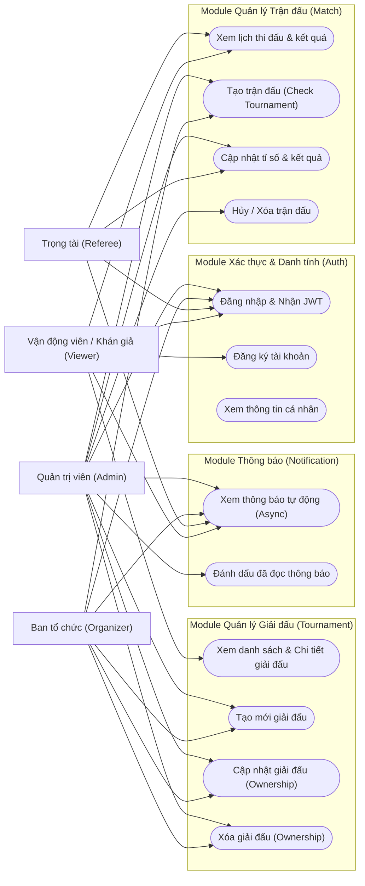
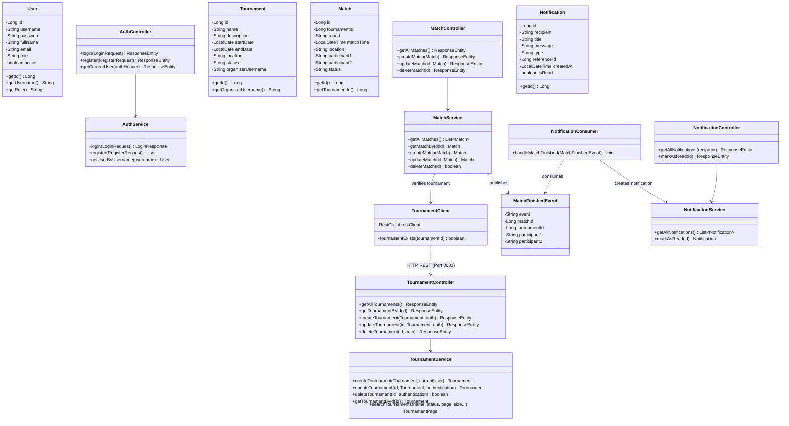
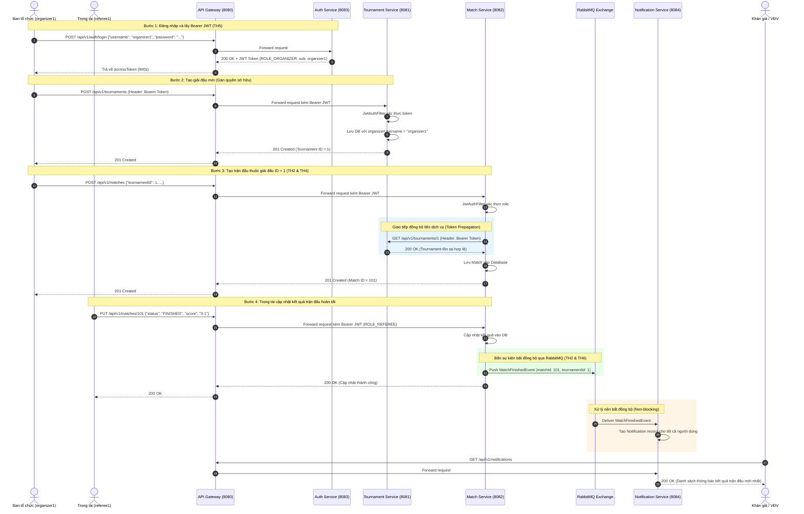
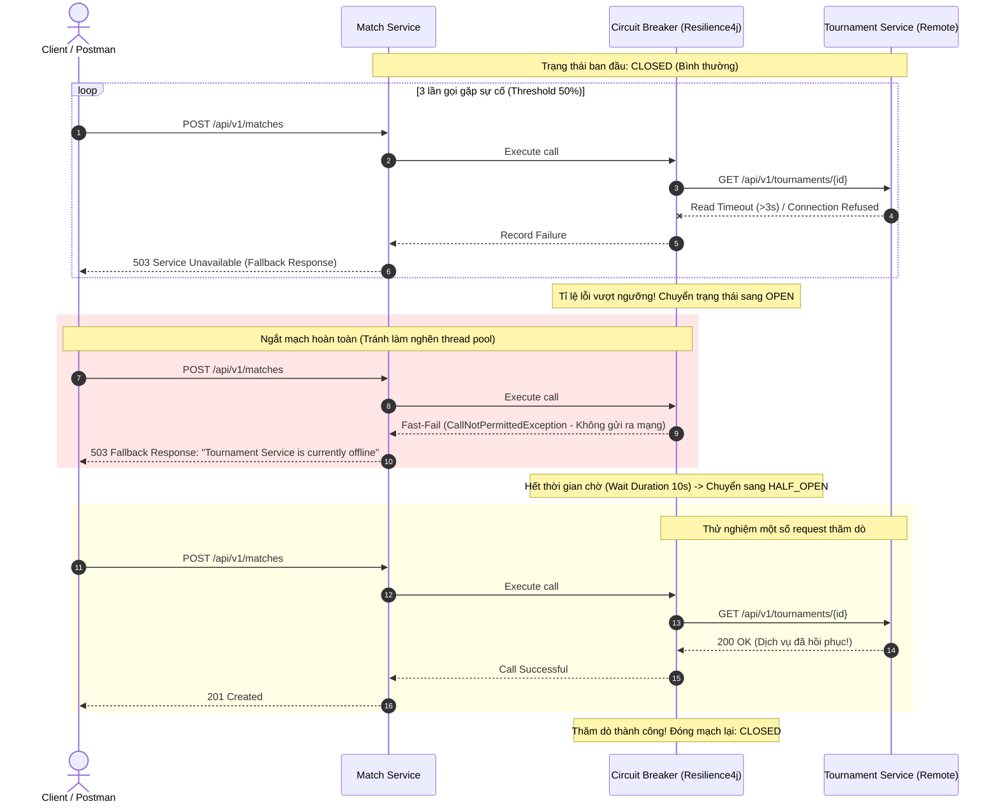
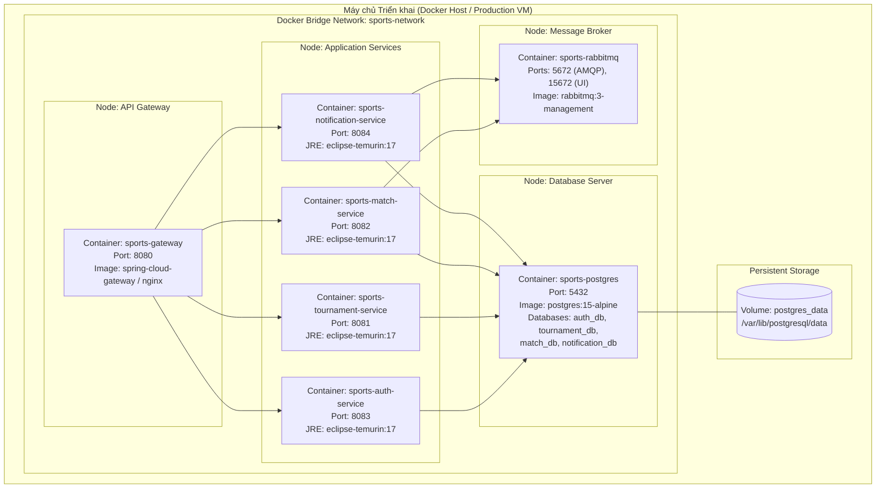
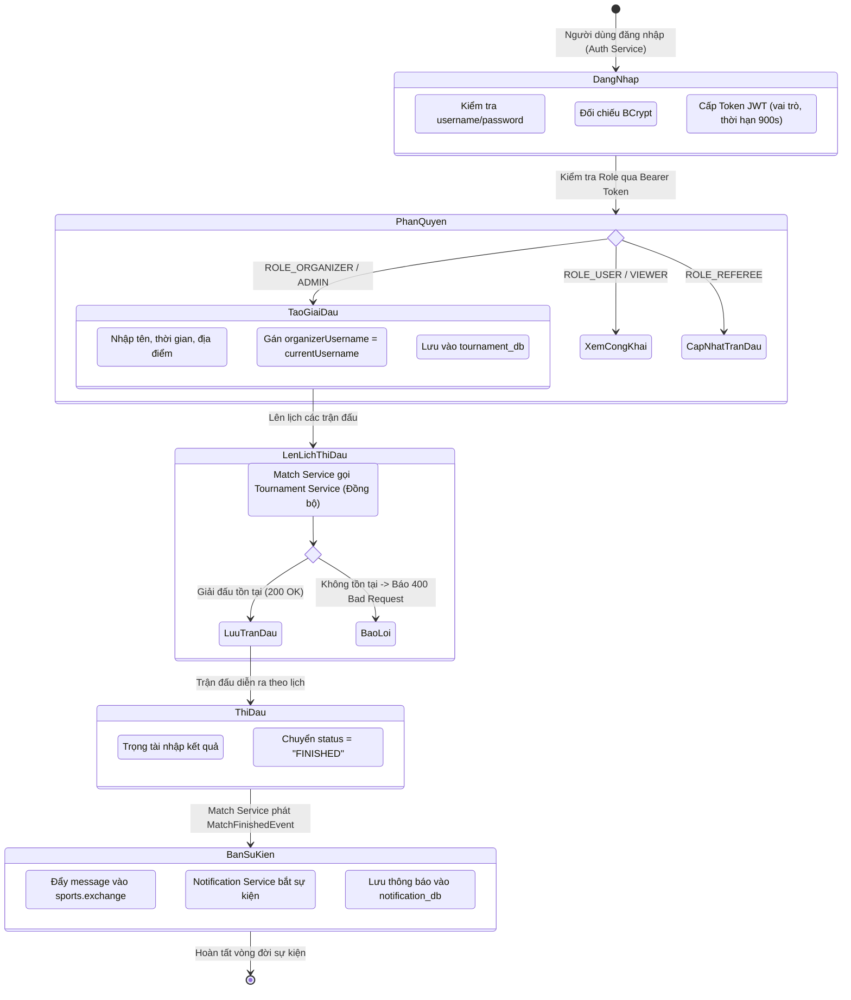

# TỔNG HỢP HỆ THỐNG BIỂU ĐỒ UML TOÀN DIỆN (TH1 → TH10)
**Học phần:** Phát triển phần mềm hướng dịch vụ (PTPMHDV)  
**Đề tài Bài tập lớn:** Hệ thống Quản lý Thể thao (Sports Management Multi-Service System)  
**Kiến trúc:** Microservices Phân tán kết hợp Event-Driven Architecture & Containerization  

---

## 1. Sơ đồ Kiến trúc Tổng thể Hệ thống (Master Microservices Architecture)

Sơ đồ mô tả bức tranh toàn cảnh của hệ thống Sports Management System từ Client tới Gateway, các Microservices nghiệp vụ, Message Broker, Cơ sở dữ liệu độc lập và Hệ thống Giám sát:

```mermaid
graph TD
    subgraph Clients["Tầng Client & Người dùng"]
        WebAdmin["Web Admin / Ban tổ chức"]
        MobileUser["Mobile App / Vận động viên / Khán giả"]
        PostmanClient["Postman / Automated Test Suite"]
    end

    subgraph GatewayLayer["Tầng Cổng giao tiếp & Bảo mật (TH7)"]
        APIGateway["API Gateway (Port 8080)<br/>- Reverse Proxy & Routing<br/>- Centralized JWT Validation<br/>- Rate Limiting & SSL"]
    end

    subgraph ServiceRegistryLayer["Tầng Quản lý Dịch vụ (TH7)"]
        Discovery["Service Registry (Eureka Server)<br/>Port 8761<br/>- Dynamic Discovery<br/>- Heartbeat & Health Status"]
    end

    subgraph BusinessServices["Tầng Dịch vụ Nghiệp vụ (Core Microservices)"]
        AuthSvc["Auth Service (Port 8083)<br/>- User Management<br/>- BCrypt Password Hash<br/>- Issue JWT Token"]
        TournamentSvc["Tournament Service (Port 8081)<br/>- Tournament Lifecycle<br/>- Resource Ownership Check<br/>- Rules & Registration"]
        MatchSvc["Match Service (Port 8082)<br/>- Match Scheduling<br/>- Score & Result Updates<br/>- Token Propagation"]
        NotificationSvc["Notification Service (Port 8084)<br/>- Event Consumer<br/>- Notification Storage<br/>- Mock Push/Email"]
    end

    subgraph MessagingLayer["Tầng Giao tiếp Bất đồng bộ (TH2 & TH6)"]
        RabbitMQ{{"RabbitMQ Broker (Port 5672)<br/>Exchange: sports.exchange<br/>Queue: sports.notification.queue"}}
    end

    subgraph DataLayer["Tầng Cơ sở Dữ liệu Độc lập (Database per Service - TH4)"]
        DB_Auth[("auth_db<br/>(PostgreSQL)")]
        DB_Tour[("tournament_db<br/>(PostgreSQL)")]
        DB_Match[("match_db<br/>(PostgreSQL)")]
        DB_Notif[("notification_db<br/>(PostgreSQL)")]
    end

    subgraph Observability["Tầng Giám sát & Khả năng phục hồi (TH9 & TH10)"]
        Actuator["Spring Actuator / Metrics"]
        CircuitBreaker["Resilience4j Circuit Breaker"]
    end

    %% Client traffic
    WebAdmin -->|HTTPS| APIGateway
    MobileUser -->|HTTPS| APIGateway
    PostmanClient -->|HTTP| APIGateway

    %% Gateway Routing
    APIGateway -->|/api/v1/auth/**| AuthSvc
    APIGateway -->|/api/v1/tournaments/**| TournamentSvc
    APIGateway -->|/api/v1/matches/**| MatchSvc
    APIGateway -->|/api/v1/notifications/**| NotificationSvc

    %% Service Registry
    AuthSvc -.->|Register & Heartbeat| Discovery
    TournamentSvc -.->|Register & Heartbeat| Discovery
    MatchSvc -.->|Register & Heartbeat| Discovery
    NotificationSvc -.->|Register & Heartbeat| Discovery

    %% Synchronous Service Communication
    MatchSvc -->|REST: GET /tournaments/{id}<br/>(Token Propagation + Circuit Breaker)| TournamentSvc

    %% Asynchronous Event Publishing & Consuming
    MatchSvc -->|Publish: MATCH_FINISHED| RabbitMQ
    RabbitMQ -->|Consume Message| NotificationSvc

    %% Database Connections
    AuthSvc --- DB_Auth
    TournamentSvc --- DB_Tour
    MatchSvc --- DB_Match
    NotificationSvc --- DB_Notif
```

---

## 2. Biểu đồ Ca sử dụng Tổng thể (System Use Case Diagram)

Bao quát toàn bộ chức năng từ TH1 đến TH10 với 4 nhóm người dùng chính:



---

## 3. Biểu đồ Lớp Chi tiết Đa dịch vụ (System Class Diagram)

Thể hiện mô hình hướng đối tượng, các Entity, Service, Controller, DTO, Repository và Messaging qua các dịch vụ:



---

## 4. Biểu đồ Tuần tự Nghiệp vụ End-to-End Hoàn chỉnh (End-to-End Sequence Diagram - TH6)

Mô tả một nghiệp vụ hoàn chỉnh đi xuyên qua toàn bộ các dịch vụ: Đăng nhập → Tạo giải đấu → Tạo trận đấu (giao tiếp đồng bộ) → Cập nhật kết quả → Bắn sự kiện RabbitMQ → Nhận thông báo (giao tiếp bất đồng bộ):



---

## 5. Biểu đồ Tuần tự Khả năng Phục hồi (Circuit Breaker & Fallback - TH10)

Mô tả cơ chế tự động bảo vệ hệ thống khi dịch vụ đối tác (`Tournament Service`) gặp sự cố quá tải hoặc mất mạng:



---

## 6. Biểu đồ Triển khai (UML Deployment Diagram - Docker Multi-Container - TH8)

Mô hình triển khai container hóa toàn bộ hệ sinh thái dịch vụ qua Docker Compose:



---

## 7. Biểu đồ Hoạt động Nghiệp vụ Toàn trình (Activity Diagram)

Mô tả vòng đời khép kín của Giải đấu và Trận đấu trong hệ thống:


