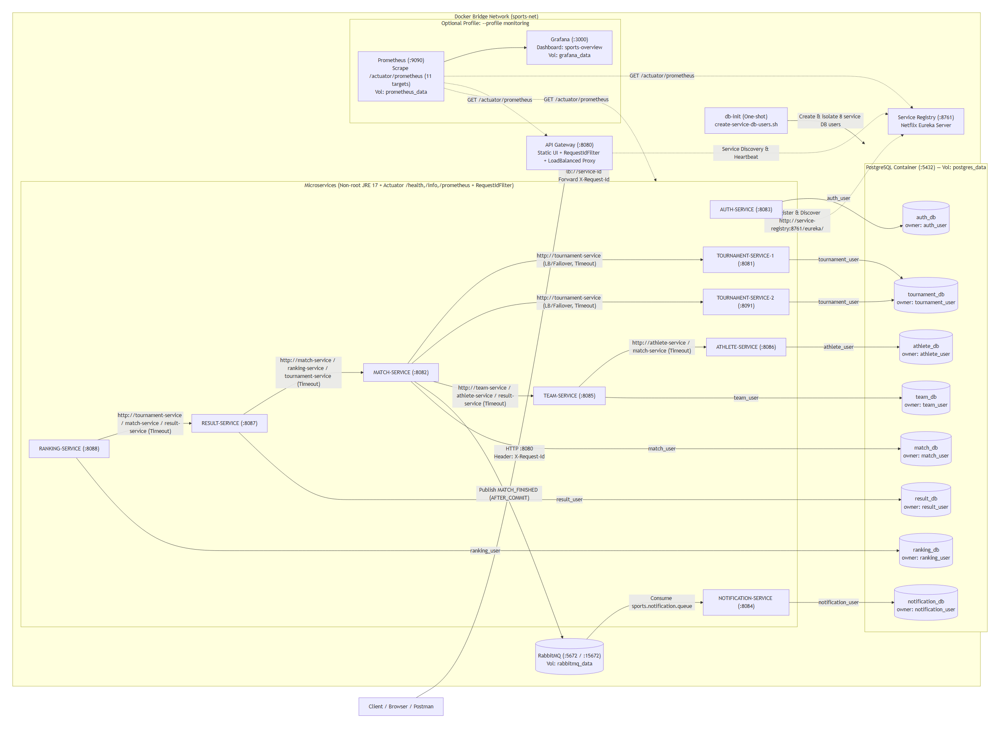

# Hệ thống Quản lý Thi đấu Thể thao (Sports Management System)

Hệ thống Quản lý Thi đấu Thể thao đa môn được xây dựng theo **kiến trúc Microservices / SOA** trên nền **Spring Boot 4.1.1 (Java 17)**, áp dụng mô hình **Database-per-Service (PostgreSQL)**, Service Registry & Discovery qua **Netflix Eureka + Spring Cloud LoadBalancer**, giao tiếp bất đồng bộ qua **RabbitMQ**, xác thực **JWT HMAC-SHA256 + RBAC + Resource Ownership**, giám sát qua **Spring Boot Actuator**, và đóng gói triển khai hoàn chỉnh bằng **Docker & Docker Compose** (multi-stage build, non-root runtime).

---

## 1. Kiến trúc 10 Microservices & Bảng kết nối



| STT | Module | Service ID (Eureka) | Cổng nội bộ / Publish | CSDL sở hữu | Số instance | Vai trò & Kết nối |
| :-: |---|---| :-: |---| :-: |---|
| 1 | `service-registry` | `SERVICE-REGISTRY` | `8761` | — | `1` | Netflix Eureka Server (nhận đăng ký & heartbeat qua Docker DNS `service-registry:8761`) |
| 2 | `api-gateway` | `API-GATEWAY` | `8080` | Stateless | `1` | Static SPA + Proxy `lb://<service-id>` tới 8 business service, giới hạn CORS |
| 3 | `auth-service` | `AUTH-SERVICE` | `8083` | `auth_db` | `1` | Tài khoản, chuẩn hóa username, BCrypt, cấp JWT (5 vai trò RBAC) |
| 4 | `tournament-service` | `TOURNAMENT-SERVICE` | `8081`, `8091` | `tournament_db` | **`2`** | Giải đấu, môn, nội dung, điều lệ & thể thức; **2 instance dùng chung `tournament_db`** minh họa Load Balancing & Failover; gọi `match-service`, `ranking-service` |
| 5 | `team-service` | `TEAM-SERVICE` | `8085` | `team_db` | `1` | Đội tuyển & đội hình; gọi `athlete-service`, `match-service` kiểm tra quyền & điều lệ |
| 6 | `athlete-service` | `ATHLETE-SERVICE` | `8086` | `athlete_db` | `1` | Hồ sơ VĐV, CCCD duy nhất, bảo vệ PII; gọi `team-service`, `match-service` trước khi xóa |
| 7 | `match-service` | `MATCH-SERVICE` | `8082` | `match_db` | `1` | Đăng ký/duyệt tham dự, xếp lịch, trùng lịch; gọi `tournament-service`, `team-service`, `athlete-service`, `result-service`; phát sự kiện RabbitMQ |
| 8 | `result-service` | `RESULT-SERVICE` | `8087` | `result_db` | `1` | Nhập/xác nhận kết quả & phục hồi đồng bộ; gọi `match-service`, `tournament-service`, `ranking-service` |
| 9 | `ranking-service` | `RANKING-SERVICE` | `8088` | `ranking_db` | `1` | Tính & lưu BXH; gọi `tournament-service`, `match-service`, `result-service` |
| 10 | `notification-service` | `NOTIFICATION-SERVICE` | `8084` | `notification_db` | `1` | Nhận sự kiện `MATCH_FINISHED` từ RabbitMQ, phân quyền xem công khai/riêng tư & đánh dấu đã đọc |

Xem chi tiết kiến trúc, quan hệ Consumer/Provider và thiết kế Docker Compose tại [`docs/deployment/deployment-design.md`](docs/deployment/deployment-design.md).

---

## 2. Yêu cầu cài đặt

- **Docker Engine / Docker Desktop** và **Docker Compose v2** (`docker compose version`).
- Không cần cài sẵn JDK 17 hoặc Maven nếu chạy bằng Docker Compose: các `Dockerfile` đều sử dụng **multi-stage build** (`maven:3.9-eclipse-temurin-17-alpine` build trực tiếp từ mã nguồn mới nhất, chạy bằng `eclipse-temurin:17-jre-alpine` với user non-root `appuser`).
- *(Tùy chọn cho phát triển / chạy test Maven cục bộ)*: **Java 17+** và Maven Wrapper (`./mvnw` hoặc `.\mvnw.cmd`).

---

> **Chạy bằng IntelliJ (`.run/`):** các cấu hình chạy không chứa mật khẩu hay JWT secret. Trước khi chạy, đặt hai biến môi trường Windows một lần rồi mở lại IntelliJ:
> ```powershell
> setx JWT_SECRET "<chuoi-ngau-nhien-toi-thieu-32-ky-tu>"
> setx SPRING_DATASOURCE_PASSWORD "<mat-khau-postgres-cua-ban>"
> ```

---

## 3. Hướng dẫn triển khai từ đầu bằng Docker Compose

### Bước 1: Chuẩn bị file biến môi trường `.env`

Sao chép [`.env.example`](.env.example) thành `.env` (file `.env` được bỏ qua trong `.gitignore`, **không** commit secret lên Git):

```powershell
Copy-Item .env.example .env
```

Mở `.env` và cấu hình tối thiểu các giá trị sau:
- `JWT_SECRET`: chuỗi ngẫu nhiên tối thiểu **32 ký tự**.
- `DB_USERNAME` / `DB_PASSWORD`: tài khoản PostgreSQL (mặc định `DB_USERNAME=sports`), là chủ sở hữu cả 8 database được khởi tạo.
- `CORS_ALLOWED_ORIGINS`: danh sách origin hợp lệ (mặc định `http://localhost:8080`, cấm `*`).
- Các biến cổng (`GATEWAY_PORT=8080`, `REGISTRY_PORT=8761`, `POSTGRES_PORT=5432`, ...) giữ mặc định hoặc đổi nếu cổng máy chủ đang bận.

> **Lưu ý khởi tạo DB & RabbitMQ:**
> - Script [`docker/init-multiple-dbs.sql`](docker/init-multiple-dbs.sql) chạy dưới tài khoản `POSTGRES_USER` (`${DB_USERNAME:-sports}`) nên tự động tạo sẵn 8 database riêng thuộc quyền sở hữu của `DB_USERNAME` cấu hình trong `.env` (không gán cứng user `sports`). Script **chỉ tự động chạy khi volume `postgres_data` được tạo mới (rỗng)**; không xóa volume đang chứa dữ liệu để ép chạy lại.
> - Container `rabbitmq` được cố định `hostname: rabbitmq` để giữ ổn định Erlang node name (`rabbit@rabbitmq`) khi `docker compose down` rồi `up -d`. Lưu ý nếu nâng cấp từ một volume cũ từng khởi tạo với hostname ngẫu nhiên khác, việc đổi `hostname` sẽ không tự di chuyển dữ liệu cũ từ node name trước đó.

### Bước 2: Build image từ mã nguồn mới nhất và khởi động hệ thống

```powershell
docker compose up -d --build
```
*(File [`docker-compose.yml`](docker-compose.yml) đã cố định `name: sports-management-system` — trùng với mặc định của [`test_th8_deployment.ps1`](test_th8_deployment.ps1) — nên thao tác thủ công và script kiểm thử dùng chung một Compose project, tránh vô tình tạo hai cụm trùng cổng.)*

Kiểm tra trạng thái toàn bộ container (đợi 13/13 container đạt `healthy`):

```powershell
docker compose ps
```

### Bước 3: Địa chỉ truy cập & Kiểm tra Health

- **Giao diện Web (API Gateway):** `http://localhost:8080`
- **Eureka Server Dashboard:** `http://localhost:8761`
- **RabbitMQ Management UI:** `http://localhost:15672` (mặc định `guest` / `guest`)
- **Gateway Routes & Eureka Discovery API:** `http://localhost:8080/api/v1/gateway/routes`
- **Kiểm tra Actuator Health & Prometheus từng service** (chỉ expose `health,info,prometheus` với `show-details=never`, trả `{"status":"UP"}`):
  ```powershell
  foreach ($p in @(8761,8080,8081,8091,8082,8083,8084,8085,8086,8087,8088)) {
    Write-Host "$p ->" (Invoke-RestMethod "http://127.0.0.1:$p/actuator/health" | ConvertTo-Json -Compress)
  }
  ```

---

## 4. Bật tài khoản Demo phục vụ kiểm thử (Tắt mặc định)

Vì lý do bảo mật, tài khoản demo **luôn tắt mặc định** (`APP_DEMO_ENABLED=false`, `APP_DEMO_SEED_USERS=false`). Khi cần đăng nhập thử nghiệm trên giao diện hoặc chạy kiểm thử tự động, đặt trong `.env`:

```env
APP_DEMO_ENABLED=true
APP_DEMO_SEED_USERS=true
```

Sau đó cập nhật container `api-gateway` và `auth-service` (`docker compose up -d api-gateway auth-service`):

| Username | Mật khẩu | Vai trò | Ghi chú |
|---|---|---|---|
| `admin` | `admin123` | `ROLE_ADMIN` | Quản trị hệ thống |
| `organizer1` | `organizer123` | `ROLE_ORGANIZER` | Ban tổ chức giải 1 |
| `organizer2` | `organizer123` | `ROLE_ORGANIZER` | Ban tổ chức giải 2 |
| `referee1` | `referee123` | `ROLE_REFEREE` | Trọng tài |
| `manager1` | `manager123` | `ROLE_TEAM_MANAGER` | Lãnh đội |
| `user1` | `user123` | `ROLE_VIEWER` | Khán giả |

---

## 5. Vận hành: Xem log, Dừng, Khởi động lại & Bảo toàn dữ liệu

```powershell
# Xem log toàn hệ thống hoặc theo dõi từng service
docker compose logs --tail=100
docker compose logs -f match-service

# Dừng / khởi động lại một dịch vụ (ví dụ kiểm thử Failover)
docker compose stop tournament-service
docker compose start tournament-service

# Restart PostgreSQL hoặc một service mà không mất dữ liệu
docker compose restart postgres-db tournament-service

# Dừng toàn hệ thống NHƯNG GIỮ NGUYÊN DỮ LIỆU (named volumes postgres_data, rabbitmq_data)
docker compose down

# Khởi động lại toàn bộ hệ thống từ volume đã lưu
docker compose up -d
```

> **Quan trọng:** Không dùng `docker compose down -v` khi muốn bảo toàn dữ liệu, vì tùy chọn `-v` sẽ xóa sạch các volume dữ liệu của PostgreSQL và RabbitMQ. Xem thêm cách xử lý các lỗi thường gặp (trùng cổng, thiếu `JWT_SECRET`, `503` khi provider dừng, volume cũ thiếu DB) tại [`docs/operation/operation-guide.md`](docs/operation/operation-guide.md) và [`docs/operation/failure-analysis.md`](docs/operation/failure-analysis.md).

---

## 6. Kiểm thử (Maven + Docker Deployment TH8)

### 6.1. Kiểm thử Unit/Integration Maven toàn dự án
```powershell
.\mvnw.cmd test
node --check api-gateway/src/main/resources/static/js/app.js
```

### 6.2. Kiểm thử triển khai Docker Compose thực tế (`DEP01`–`DEP06` & `SPORT01`–`SPORT04`)
```powershell
# Chạy trên cụm Docker chuẩn (project sports-management-system, trùng với docker compose up -d)
# Yêu cầu .env đã bật APP_DEMO_ENABLED=true và APP_DEMO_SEED_USERS=true cho bước tạo dữ liệu thử
powershell -ExecutionPolicy Bypass -File .\test_th8_deployment.ps1

# Hoặc chạy cách ly hoàn toàn trên project, volume & bộ cổng riêng (tránh đụng cụm đang chạy):
powershell -ExecutionPolicy Bypass -File .\test_th8_deployment.ps1 -ComposeProjectName sports_th8_test -EnvFile <duong-dan-env-rieng>
```

---

> **Nâng cấp vận hành:** tài khoản database riêng cho từng service, mã theo dõi `X-Request-Id`, timeout cho lời gọi liên dịch vụ và profile giám sát Prometheus/Grafana — xem mục 6–9 của [`docs/operation/operation-guide.md`](docs/operation/operation-guide.md).

## 7. Cấu trúc tài liệu Bài thực hành 8 (`docs/`)

- [`docs/deployment/deployment-architecture.png`](docs/deployment/deployment-architecture.png) *(nguồn Mermaid: [`deployment-architecture.mmd`](docs/deployment/deployment-architecture.mmd))* — Sơ đồ kiến trúc triển khai tổng thể.
- [`docs/deployment/deployment-design.md`](docs/deployment/deployment-design.md) — Bảng rà soát 10 module, phụ thuộc Consumer/Provider, thiết kế 2 instance, Database-per-Service, Actuator & Log.
- [`docs/operation/operation-guide.md`](docs/operation/operation-guide.md) — Hướng dẫn cài đặt, khởi động, kiểm tra sức khỏe, xem log, bảo toàn dữ liệu và xử lý sự cố.
- [`docs/operation/failure-analysis.md`](docs/operation/failure-analysis.md) — Phân tích các lỗi thực tế và kịch bản sự cố đã kiểm chứng.
- [`docs/test/deployment-test-cases.md`](docs/test/deployment-test-cases.md) — Bộ test case `DEP01`–`DEP06`, `SPORT01`–`SPORT04` và kiểm tra monitoring kèm kết quả chạy thực tế.
- [`docs/test/test-results/`](docs/test/test-results/) — Log thực tế, kết quả JSON, ảnh `docker compose ps` và Eureka Dashboard.

## 8. Bản đồ tài liệu và bằng chứng theo bài thực hành (TH1–TH8)

| Bài | Nội dung | Tài liệu / mã nguồn | Bằng chứng kiểm thử |
|---|---|---|---|
| TH1 | CRUD RESTful, `/hello`, `/info` | Các `*Controller.java`, Swagger `/swagger-ui.html` | [`tests/postman/th1-th3-crud.postman_collection.json`](tests/postman/th1-th3-crud.postman_collection.json), [`th1-th3-crud-newman.json`](docs/test/test-results/th1-th3-crud-newman.json) |
| TH2 | Provider/Consumer, đa framework, xử lý lỗi gọi service | [`framework-comparison/express-tournament-consumer/`](framework-comparison/express-tournament-consumer/), [`so-sanh-framework.md`](framework-comparison/so-sanh-framework.md) | [`ket-qua-chay.md`](framework-comparison/ket-qua-chay.md), `npm test` |
| TH3 | Thiết kế REST, phân trang/lọc/sắp xếp, versioning | [`docs/rest-api-design.md`](docs/rest-api-design.md) | Như TH1 |
| TH4 | Database-per-Service, transaction, kết nối service | [`docs/data-and-service-design.md`](docs/data-and-service-design.md) | `RabbitMQContractAndAfterCommitTest` (Maven) |
| TH5 | JWT, RBAC, ownership | [`security-design/`](security-design/) | [`security-design/test-results.md`](security-design/test-results.md), [`security-th5-newman.json`](docs/test/test-results/security-th5-newman.json) |
| TH6 | Tích hợp REST + RabbitMQ | [`integration/`](integration/) | [`integration/test-results.md`](integration/test-results.md), [`integration-th6-newman.json`](docs/test/test-results/integration-th6-newman.json) |
| TH7 | Eureka, cân bằng tải, failover | [`docs/service-registry/`](docs/service-registry/), [`test_th7_service_discovery.ps1`](test_th7_service_discovery.ps1) | [`service-discovery-th7-newman.json`](docs/test/test-results/service-discovery-th7-newman.json), `th7-service-discovery-run.txt` |
| TH8 | Docker, Compose, giám sát | Mục 3–7 ở trên | [`docs/test/deployment-test-cases.md`](docs/test/deployment-test-cases.md), [`test_th8_deployment.ps1`](test_th8_deployment.ps1) |

Tổng hợp đối chiếu: [`BAO_CAO_THUC_HANH_1_DEN_8.md`](BAO_CAO_THUC_HANH_1_DEN_8.md), [`docs/05-DOI-CHIEU-TH1-TH8-2026-11-17.md`](docs/05-DOI-CHIEU-TH1-TH8-2026-11-17.md), lịch sử sửa lỗi [`KET_QUA_SUA_LOI.md`](KET_QUA_SUA_LOI.md).
