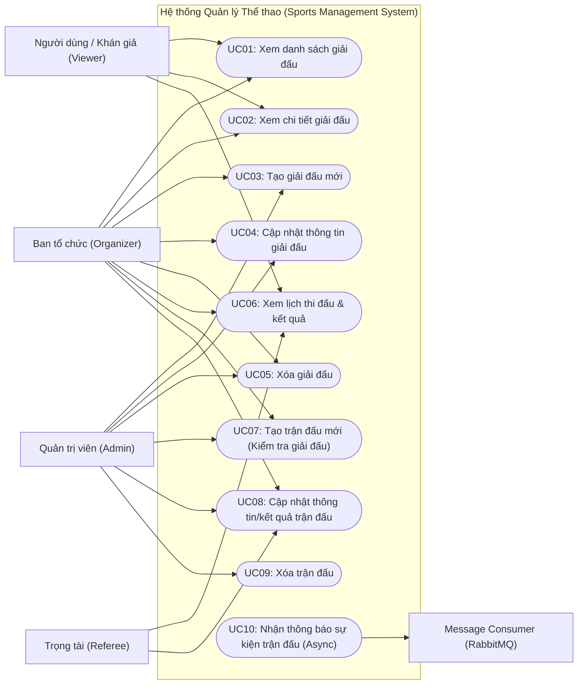
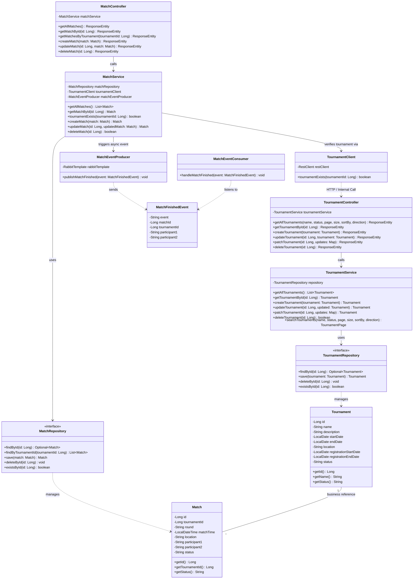
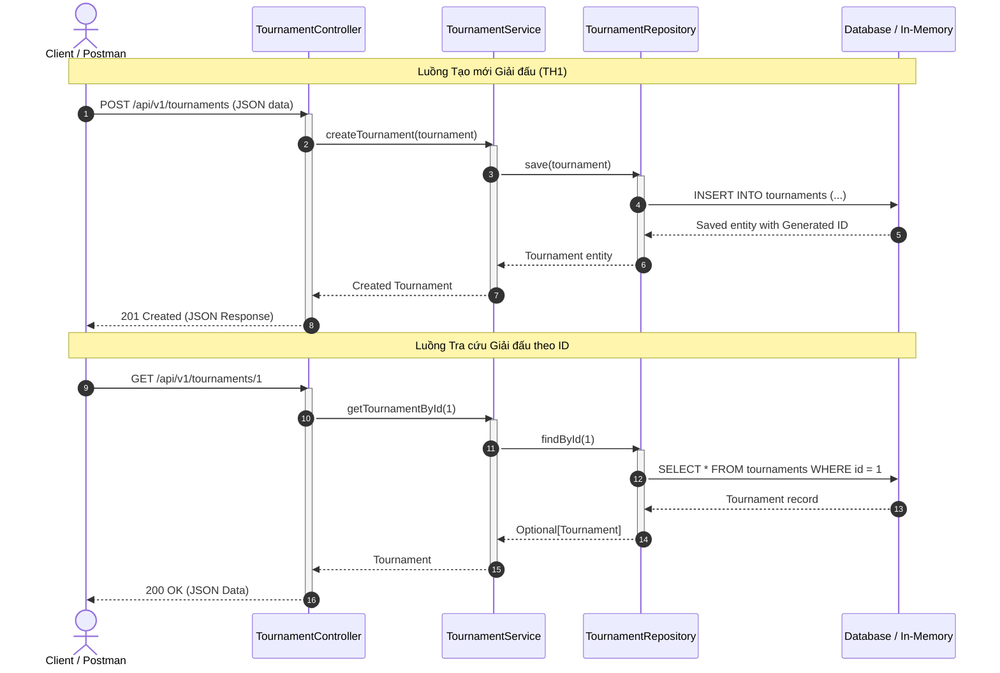
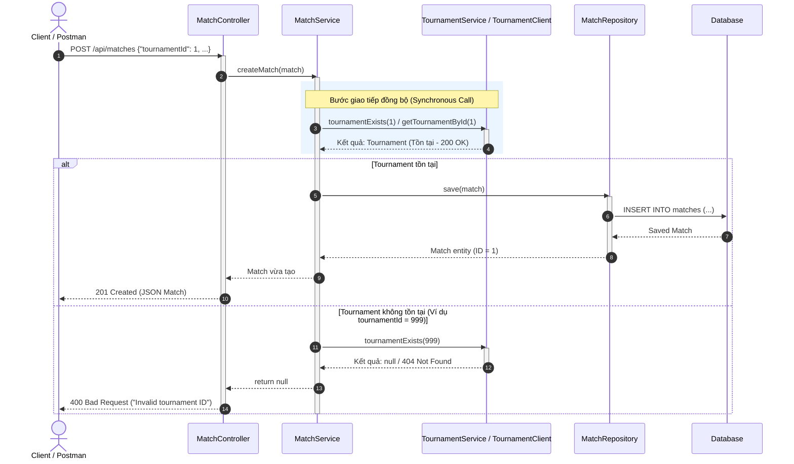
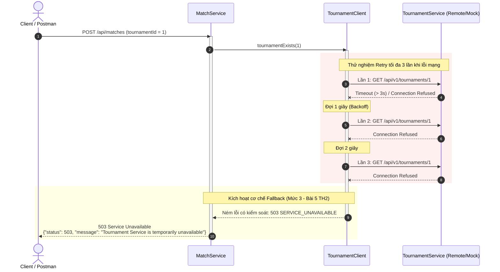
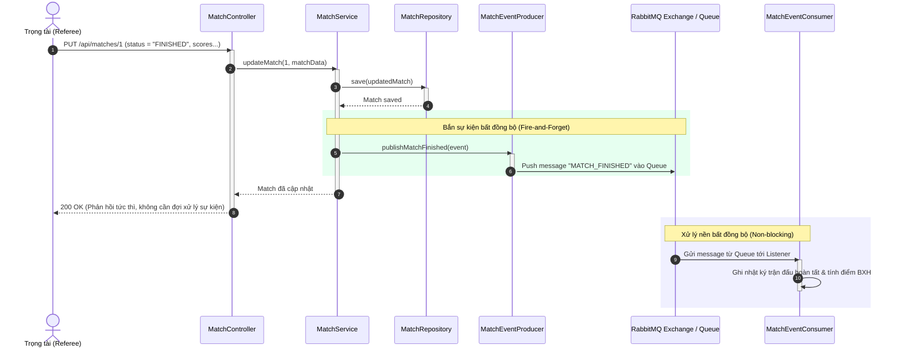
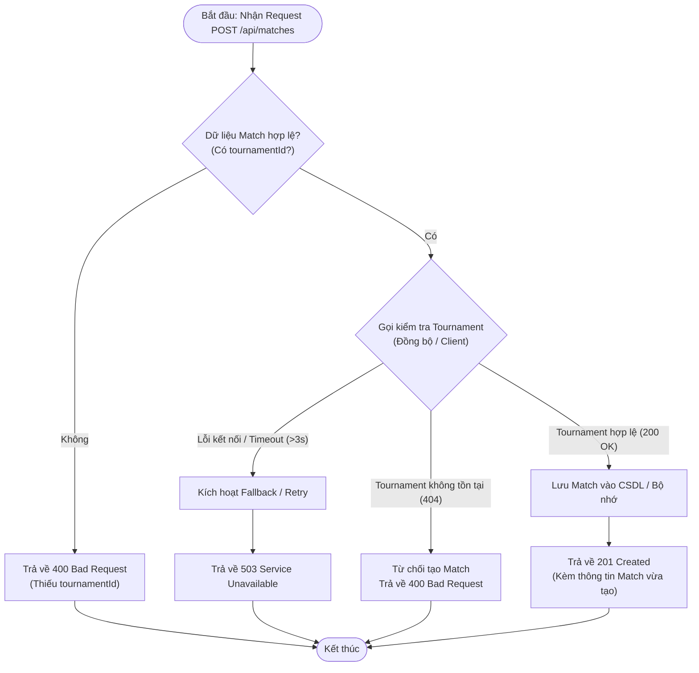
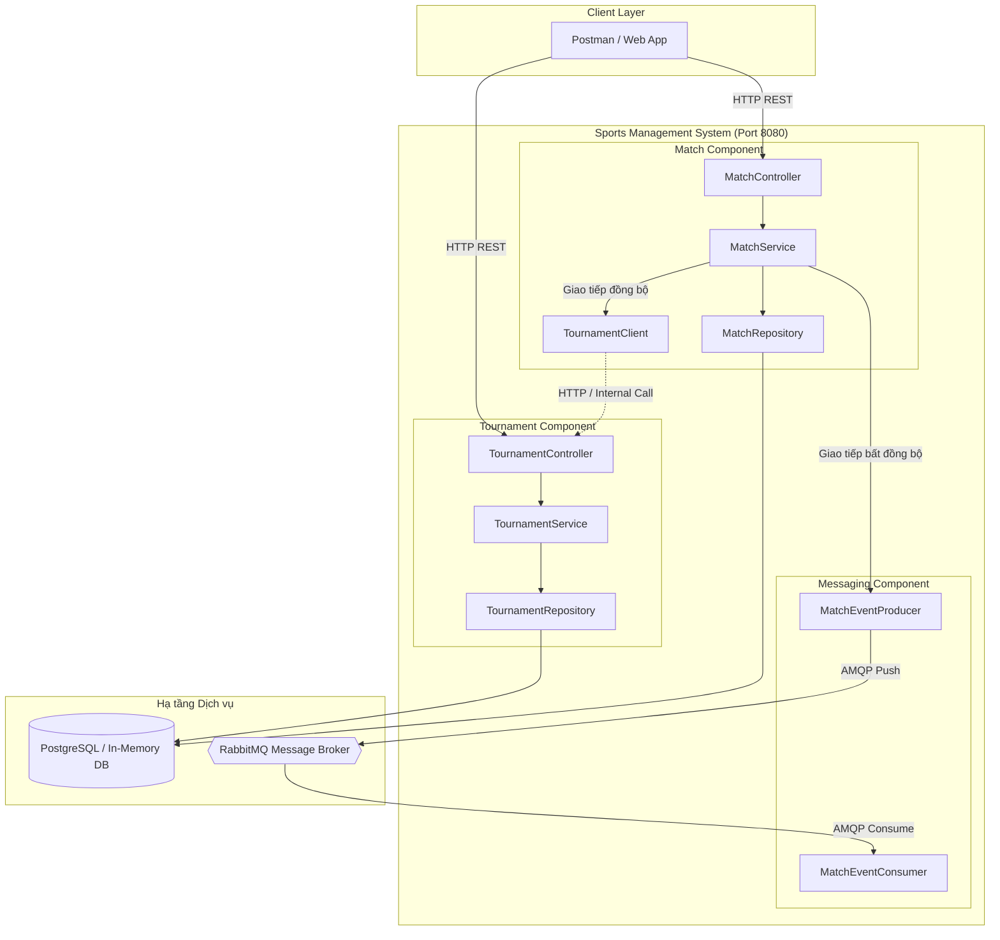

# PHÂN TÍCH THIẾT KẾ UML (TH1 - TH2) & BÁO CÁO TỔNG HỢP CUỐI BUỔI THỰC HÀNH 2
**Học phần:** Phát triển phần mềm hướng dịch vụ (PTPMHDV)  
**Hệ thống áp dụng:** Hệ thống Quản lý Thể thao (Sports Management System)  
**Mô hình triển khai:** Ứng dụng tích hợp duy nhất (`localhost:8080`) — Đa module dịch vụ  

---

# PHẦN 1: HỆ THỐNG BIỂU ĐỒ UML TOÀN DIỆN (TH1 & TH2)

Trong mô hình kiến trúc theo định hướng của nhóm, toàn bộ hệ thống chạy trên một tiến trình Spring Boot duy nhất (`SportsManagementSystemApplication` — Port 8080). Các chức năng nghiệp vụ được phân chia thành các package/component độc lập (`tournament`, `match`, `messaging`), đảm bảo nguyên tắc phân tách trách nhiệm (Separation of Concerns) và sẵn sàng tách thành các microservice độc lập khi cần.

---

## 1. Biểu đồ Ca sử dụng (Use Case Diagram)

Biểu đồ mô tả sự tương tác giữa các tác nhân (Actors) và các chức năng của hệ thống trong TH1 (Quản lý Giải đấu) và TH2 (Quản lý Trận đấu & Giao tiếp dịch vụ):



---

## 2. Biểu đồ Lớp (Class Diagram)

Biểu đồ lớp phân tích thiết kế chi tiết kiến trúc phân tầng (Controller → Service → Repository → Model/Entity) của hai module cốt lõi `tournament` và `match`, cùng thành phần giao tiếp bất đồng bộ `messaging`:



---

## 3. Biểu đồ Tuần tự (Sequence Diagrams)

### 3.1. Sơ đồ 1 (TH1): CRUD Giải đấu (Tournament Management)
Minh họa luồng request/response cơ bản từ Client tới tầng Controller, Service và Repository:



---

### 3.2. Sơ đồ 2 (TH2): Giao tiếp Đồng bộ (Synchronous) — Tạo Trận đấu có kiểm tra Giải đấu
Minh họa điểm mấu chốt của TH2: **Một service/component kiểm tra dữ liệu ở service khác trước khi thực hiện nghiệp vụ**.



---

### 3.3. Sơ đồ 3 (TH2 - Nâng cao): Xử lý Timeout, Retry và Fallback khi dịch vụ gián đoạn
Minh họa tình huống **Bài 4 & Bài 5 của TH2** khi dịch vụ đối tác phản hồi chậm hoặc tạm dừng hoạt động:



---

### 3.4. Sơ đồ 4 (TH2): Giao tiếp Bất đồng bộ (Asynchronous Communication) qua RabbitMQ
Minh họa Mục 4.3 của TH2: **Client cập nhật kết quả trận đấu, hệ thống gửi message bất đồng bộ qua Message Broker, không làm nghẽn client**:



---

## 4. Biểu đồ Hoạt động (Activity Diagram)

Mô tả thuật toán kiểm tra tính hợp lệ của Giải đấu trước khi khởi tạo Trận đấu:



---

## 5. Sơ đồ Kiến trúc Thành phần (Component Architecture Diagram)

Mô hình triển khai thống nhất trong một ứng dụng duy nhất (`localhost:8080`):



---

# PHẦN 2: NỘI DUNG TỔNG KẾT & CÂU HỎI CUỐI TH2 (THEO TH2.PDF)

---

## 1. Exit Ticket cuối buổi (5 câu hỏi cốt lõi kèm lời giải chi tiết)

### Câu 1: REST API và Spring Boot có phải là một khái niệm không? Giải thích.
* **Trả lời:** **KHÔNG.** Đây là hai khái niệm hoàn toàn khác biệt ở hai tầng bản chất:
  1. **REST API (Representational State Transfer):** Là một **kiểu kiến trúc phần mềm (Architectural Style)** và chuẩn giao tiếp dựa trên nền tảng giao thức HTTP. REST định nghĩa các nguyên tắc thiết kế như: Stateless, Resource-oriented (tài nguyên định danh bằng URI danh từ), thao tác chuẩn qua các HTTP Method (`GET`, `POST`, `PUT`, `DELETE`), trao đổi dữ liệu định dạng JSON/XML và sử dụng chuẩn mã trạng thái HTTP Status Code.
  2. **Spring Boot:** Là một **framework mã nguồn mở cụ thể của ngôn ngữ Java**, cung cấp môi trường, thư viện và công cụ để lập trình viên hiện thực hóa các ứng dụng Web/Microservices một cách nhanh chóng.
* **Minh chứng:** REST API có thể được hiện thực hóa bằng rất nhiều framework/ngôn ngữ khác nhau như Quarkus (Java), Express (Node.js), FastAPI (Python), ASP.NET Core (C#), Golang... Việc triển khai REST API không đồng nghĩa và không phụ thuộc duy nhất vào Spring Boot.

---

### Câu 2: Trong mô hình Match → Tournament (hoặc Appointment → Patient), service nào là Consumer, service nào là Provider?
* **Trả lời:**
  * **`Tournament Service` (hoặc `Patient Service`) là PROVIDER (Service cung cấp dịch vụ):** Vì nó nắm giữ dữ liệu giải đấu/bệnh nhân và cung cấp các endpoint API (ví dụ: `GET /api/v1/tournaments/{id}`) cho bên ngoài gọi vào.
  * **`Match Service` (hoặc `Appointment Service`) là CONSUMER (Service tiêu thụ dịch vụ):** Vì khi có yêu cầu tạo trận đấu mới, nó phải đóng vai trò là một client chủ động gửi HTTP Request đến `Tournament Service` để tra cứu và tiêu thụ dữ liệu nhằm xác nhận giải đấu có tồn tại hay không.

---

### Câu 3: Điều gì xảy ra nếu Tournament Service (Patient Service) bị ngừng hoạt động?
* **Trả lời:**
  * Nếu không có cơ chế phòng vệ, khi `Tournament Service` dừng hoạt động (down/sập):
    1. `Match Service` gửi HTTP request tới `Tournament Service` sẽ nhận lỗi **Connection Refused** hoặc bị treo vô thời hạn dẫn tới **Read Timeout**.
    2. Các thread trong `Match Service` bị chặn (blocked), làm cạn kiệt tài nguyên máy chủ (thread exhaustion), dẫn tới việc `Match Service` cũng bị quá tải và sập theo. Đây chính là hiện tượng **Lỗi dây chuyền (Cascading Failure)** đặc trưng trong hệ thống phân tán.
    3. Trải nghiệm người dùng bị hỏng nghiêm trọng khi nhận về lỗi HTTP 500 kèm chi tiết stack trace không an toàn.
  * **Giải pháp khắc phục:** Phải triển khai cấu hình Timeout hợp lý (ví dụ 3 giây), cơ chế **Retry** (thử lại tối đa 3 lần với backoff), và bộ ngắt mạch **Circuit Breaker / Fallback** để trả về phản hồi có kiểm soát (HTTP 503 hoặc dữ liệu dự phòng) bảo vệ hệ thống.

---

### Câu 4: Phân biệt Synchronous Communication và Asynchronous Communication
* **Bảng so sánh chi tiết:**

| Tiêu chí | Giao tiếp Đồng bộ (Synchronous) | Giao tiếp Bất đồng bộ (Asynchronous) |
|---|---|---|
| **Mô hình** | **Request / Response** | **Message / Event (Publish / Subscribe)** |
| **Cơ chế xử lý** | **Blocking:** Service A gửi request sang Service B và **bắt buộc phải chờ** B xử lý xong để nhận phản hồi. | **Non-blocking (Fire-and-forget):** Service A gửi message vào Message Broker rồi lập tức tiếp tục công việc của mình mà **không cần chờ** Service B. |
| **Độ phụ thuộc (Coupling)** | **Temporal Coupling cao:** Cả hai service A và B đều phải đang hoạt động đồng thời (Available) tại thời điểm gọi. | **Decoupled:** Service B có thể đang bảo trì hoặc tắt; message vẫn nằm an toàn trong Queue và sẽ được xử lý khi B khởi động lại. |
| **Giao thức phổ biến** | HTTP/REST, gRPC | AMQP (RabbitMQ), Kafka, MQTT |
| **Trường hợp áp dụng** | Khi Service A **bắt buộc cần dữ liệu ngay lập tức** để quyết định nghiệp vụ (VD: Kiểm tra giải đấu có tồn tại không trước khi tạo trận). | Khi xử lý tác vụ hậu kỳ, tốn thời gian, hoặc gửi thông báo (VD: Gửi thông báo trận đấu kết thúc, cập nhật bảng xếp hạng, gửi email). |

---

### Câu 5: Khi nào nên cân nhắc giao tiếp bất đồng bộ thay vì gọi REST trực tiếp?
Nên ưu tiên giao tiếp bất đồng bộ (Message-driven) trong 5 trường hợp sau:
1. **Tác vụ xử lý tốn nhiều thời gian (Long-running Tasks):** Ví dụ gửi email xác nhận cho hàng nghìn vận động viên, xuất báo cáo PDF, tính toán lại toàn bộ bảng xếp hạng sau giải đấu.
2. **Cần tách rời mức độ phụ thuộc giữa các dịch vụ (Decoupling):** Khi Service A không cần biết chi tiết Service nào sẽ tiêu thụ kết quả của mình; A chỉ cần phát đi sự kiện `MatchFinishedEvent`.
3. **Mô hình 1-Nhiều (One-to-Many / Fan-out):** Khi một sự kiện xảy ra cần kích hoạt nhiều dịch vụ cùng lúc (VD: Trận đấu kết thúc cần đồng thời thông báo cho: Notification Service, Ranking Service, Statistic Service).
4. **Cân bằng tải và làm mịn đỉnh tải (Peak Load Shaving / Buffering):** Khi lượng truy cập tăng đột biến, Message Queue đóng vai trò vùng đệm, giúp các service tiêu thụ xử lý dần dần theo năng lực thực tế mà không bị sập.
5. **Đảm bảo tính sẵn sàng cao (High Resilience):** Khi service đích có thể tạm thời không khả dụng, tin nhắn vẫn được lưu trữ bền vững (Durable) trên Broker và không bị mất mát dữ liệu.

---

## 2. Bảng so sánh Framework đa nền tảng (Spring Boot vs Quarkus vs Node.js + Express)

Đúng theo yêu cầu của Bài 3 (Trang 8–9 trong tài liệu `TH2.pdf`), đây là bảng khảo sát kỹ thuật so sánh cùng một nghiệp vụ trên nhiều nền tảng:

| Tiêu chí | Spring Boot | Quarkus | Node.js + Express |
|---|---|---|---|
| **Ngôn ngữ** | Java (17+) | Java (GraalVM Native / JVM) | JavaScript / TypeScript |
| **Tạo REST API** | `@RestController`, `@GetMapping`, `@PostMapping` (Spring MVC) | `@Path`, `@GET`, `@POST` (JAX-RS / RESTEasy Reactive) | `app.get()`, `app.post()`, Router middleware |
| **HTTP Client** | `RestClient`, `WebClient` | Quarkus REST Client Reactive (`@RegisterRestClient`) | `axios`, `node-fetch`, built-in `fetch` |
| **Xử lý JSON** | Jackson (`ObjectMapper`) tự động | Jackson hoặc JSON-B tự động | `express.json()` middleware built-in |
| **Quản lý Thư viện** | Maven (`pom.xml`) / Gradle | Maven (`pom.xml`) / Gradle | npm / pnpm / yarn (`package.json`) |
| **Cơ chế Cấu hình** | `application.properties` / `application.yml` | `application.properties` (MicroProfile Config) | `.env`, `process.env`, file `config.js` |
| **Thời gian khởi động** | Trung bình: **1.5s – 3.5s** | Cực nhanh: **0.05s** (Native) / **~1.0s** (JVM) | Rất nhanh: **0.3s – 0.8s** |
| **Bộ nhớ chiếm dụng (RAM)** | Khá lớn: **~250MB – 450MB** | Rất thấp: **~30MB – 60MB** (Native) | Thấp: **~40MB – 80MB** |
| **Mức độ phức tạp** | Trung bình; hệ sinh thái phong phú, nhiều tài liệu | Trung bình - Khá; tối ưu hoàn hảo cho Docker/K8s | Đơn giản, linh hoạt, cú pháp ngắn gọn |
| **Đánh giá bản chất** | Phù hợp hệ thống Enterprise lớn, ổn định cao | Lựa chọn số 1 cho Serverless, Cloud-native | Rất nhanh cho I/O bound, prototype và service nhẹ |

> **Nhận thức sư phạm cốt lõi:**  
> Kiến trúc hướng dịch vụ và giao thức giao tiếp HTTP/REST + JSON hoàn toàn **độc lập với framework triển khai**. Dù dùng Spring Boot, Quarkus hay Node.js, bản chất thông điệp gửi qua mạng vẫn là các HTTP Request/Response mang dữ liệu JSON chuẩn mực.

---

## 3. Thử thách mở rộng cuối TH2 (Mức 1 → Mức 4)

Trong bài tập của nhóm, các thử thách nâng cao đã được thiết kế như sau:

* **Mức 1 — Service Discovery giả lập & Cấu hình tập trung:**  
  Địa chỉ của service không bao giờ được hard-code trực tiếp trong mã Java mà luôn được externalize vào `application.properties`:
  ```properties
  services.tournament.url=${TOURNAMENT_SERVICE_URL:http://localhost:8080}
  ```
* **Mức 2 — Cơ chế Retry (Thử lại khi lỗi tạm thời):**  
  Khi gọi dịch vụ đối tác, cấu hình cơ chế thử lại tối đa 3 lần (Max Retry = 3) kèm khoảng chờ tăng dần (exponential backoff) trước khi kết luận thất bại.
* **Mức 3 — Cơ chế Fallback (Dự phòng có kiểm soát):**  
  Nếu dịch vụ đối tác không phản hồi hoặc bị timeout, hệ thống không để văng `500 Internal Server Error` mà chủ động bắt exception và trả về mã lỗi `503 Service Unavailable` kèm cấu trúc JSON thông báo rõ ràng:
  ```json
  {
    "status": 503,
    "message": "Tournament Service is temporarily unavailable"
  }
  ```
* **Mức 4 — Khái niệm API Gateway:**  
  Client bên ngoài chỉ tương tác qua một cổng duy nhất (Port 8080). Gateway sẽ đóng vai trò Reverse Proxy định tuyến request về đúng component (`/api/v1/tournaments/**` tới Tournament Component, `/api/v1/matches/**` tới Match Component).

---

## 4. Hướng dẫn kiểm thử 4 Test Cases chuẩn trên ứng dụng (Port 8080)

Khi khởi chạy ứng dụng duy nhất `SportsManagementSystemApplication` trên cổng `localhost:8080`, tiến hành kiểm thử theo đúng trình tự:

### Test Case 1: Tạo Giải đấu mẫu (TH1)
* **Request:** `POST http://localhost:8080/api/v1/tournaments`
* **Body:**
```json
{
  "name": "Hanoi Open 2026",
  "description": "Giai bong da sinh vien",
  "startDate": "2026-11-01",
  "endDate": "2026-11-15",
  "location": "San van dong My Dinh",
  "registrationStartDate": "2026-10-01",
  "registrationEndDate": "2026-10-25",
  "status": "OPEN"
}
```
* **Kết quả:** `201 Created`, giải đấu được tạo thành công với `id = 1`.

---

### Test Case 2: Tạo Trận đấu hợp lệ (TH2 - Synchronous Success)
* **Request:** `POST http://localhost:8080/api/v1/matches`
* **Body:**
```json
{
  "tournamentId": 1,
  "round": "ROUND_1",
  "matchTime": "2026-11-05T09:00:00",
  "location": "San A",
  "participant1": "Doi CNTT",
  "participant2": "Doi DTVT",
  "status": "SCHEDULED"
}
```
* **Kết quả:** `201 Created`, Match được tạo thành công vì `tournamentId = 1` tồn tại.

---

### Test Case 3: Tạo Trận đấu với Giải đấu KHÔNG tồn tại (TH2 - Synchronous Validation)
* **Request:** `POST http://localhost:8080/api/v1/matches`
* **Body:**
```json
{
  "tournamentId": 9999,
  "round": "FINAL",
  "matchTime": "2026-11-20T19:00:00",
  "location": "San Chinh",
  "participant1": "Doi A",
  "participant2": "Doi B",
  "status": "SCHEDULED"
}
```
* **Kết quả:** `400 Bad Request` (hoặc thông báo lỗi giải đấu không tồn tại), hệ thống **từ chối lưu Match**, dữ liệu được bảo toàn tính toàn vẹn.

---

### Test Case 4: Cập nhật Trận đấu hoàn tất & Kích hoạt Sự kiện RabbitMQ (TH2 - Asynchronous)
* **Request:** `PUT http://localhost:8080/api/v1/matches/1`
* **Body:**
```json
{
  "tournamentId": 1,
  "round": "ROUND_1",
  "matchTime": "2026-11-05T09:00:00",
  "location": "San A",
  "participant1": "Doi CNTT (Score: 3)",
  "participant2": "Doi DTVT (Score: 1)",
  "status": "FINISHED"
}
```
* **Kết quả:** `200 OK`, ứng dụng ghi nhận `MATCH_FINISHED`, `MatchEventProducer` đẩy event vào RabbitMQ và `MatchEventConsumer` nhận message in log xử lý nền thành công.
