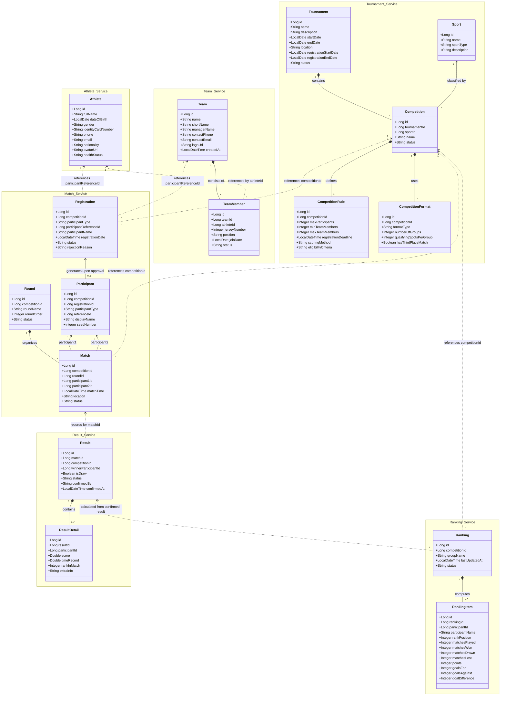
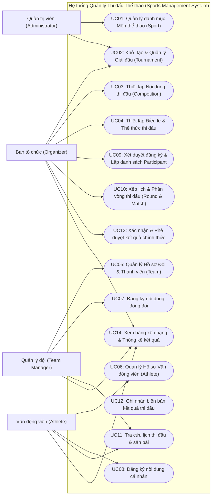
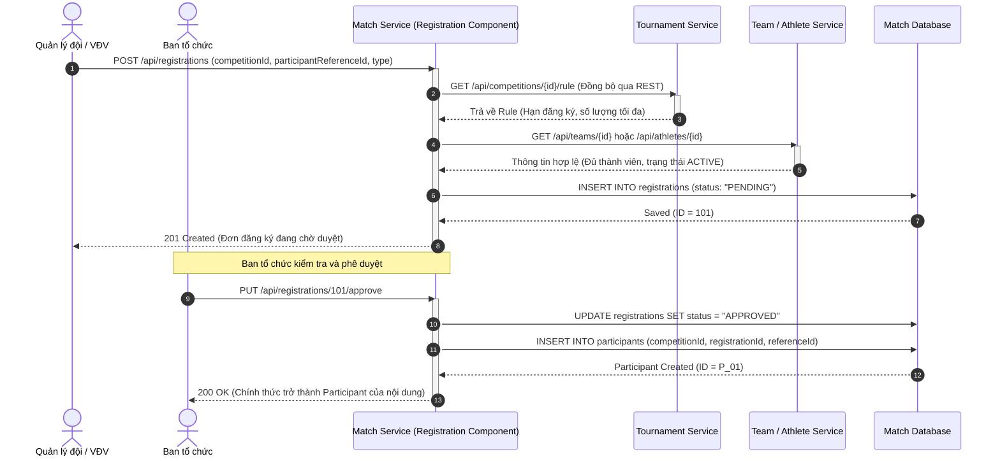
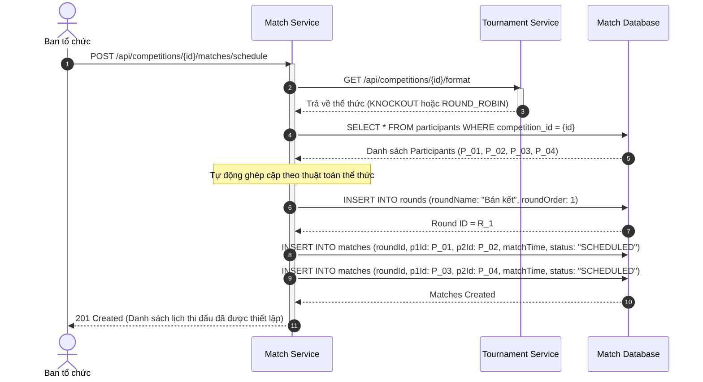
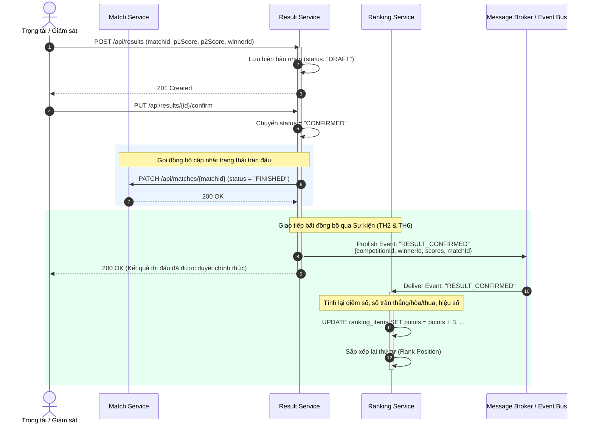
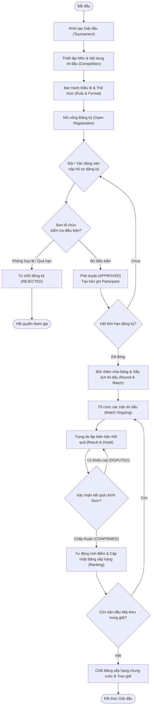
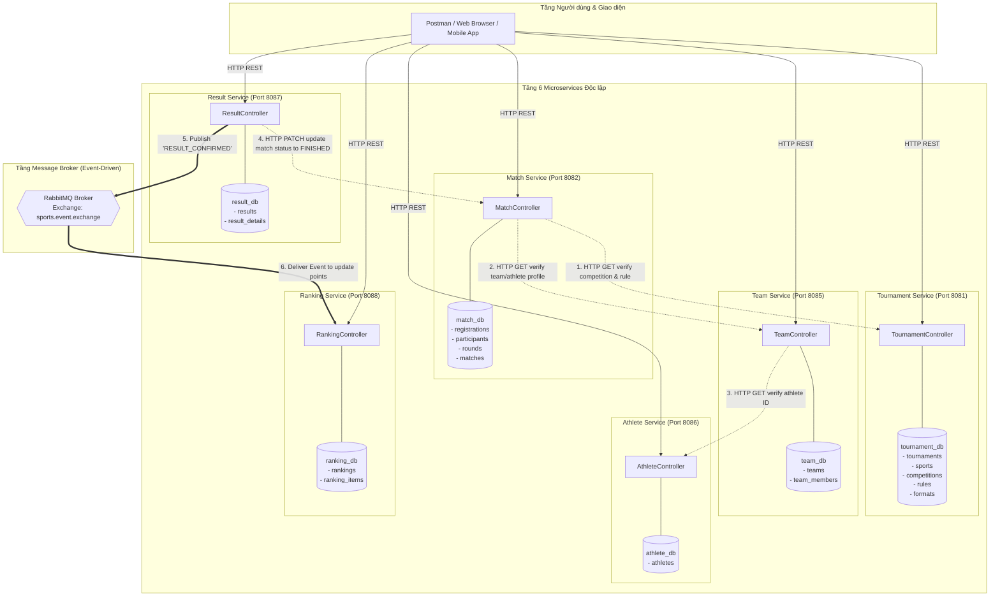

# THIẾT KẾ UML HỆ THỐNG QUẢN LÝ THI ĐẤU THỂ THAO THEO KIẾN TRÚC HƯỚNG DỊCH VỤ (SOA / MICROSERVICES)

**Đề tài:** Xây dựng và phát triển hệ thống quản lý thi đấu thể thao theo kiến trúc hướng dịch vụ  
**Cơ sở phân tích:** Chuỗi nghiệp vụ tổng quát 6 Microservices:  
`Tournament Service` ➔ `Team Service` ➔ `Athlete Service` ➔ `Match Service` ➔ `Result Service` ➔ `Ranking Service`  
**Nguyên tắc kiến trúc:** Database-per-service, Loose Coupling, Tham chiếu thực thể liên dịch vụ qua ID logic (không tạo Foreign Key vật lý chéo database).

---

## MỤC LỤC
1. [Kiến trúc Phân rã Dịch vụ & Ranh giới Nghiệp vụ](#1-kiến-trúc-phân-rã-dịch-vụ--ranh-giới-nghiệp-vụ)
2. [Chi tiết Các Lớp (Classes), Thuộc tính và Kiểu dữ liệu](#2-chi-tiết-các-lớp-classes-thuộc-tính-và-kiểu-dữ-liệu)
3. [Biểu đồ Lớp Tổng thể (System Class Diagram)](#3-biểu-đồ-lớp-tổng-thể-system-class-diagram)
4. [Biểu đồ Ca sử dụng (Use Case Diagram)](#4-biểu-đồ-ca-sử-dụng-use-case-diagram)
5. [Các Biểu đồ Tuần tự Trọng tâm (Sequence Diagrams)](#5-các-biểu-đồ-tuần-tự-trọng-tâm-sequence-diagrams)
   * 5.1. Đăng ký tham gia nội dung thi đấu (Registration Flow)
   * 5.2. Lập lịch thi đấu (Match Scheduling Flow)
   * 5.3. Ghi nhận kết quả và Cập nhật bảng xếp hạng (Result to Ranking Flow)
6. [Biểu đồ Hoạt động Toàn trình (Activity Diagram)](#6-biểu-đồ-hoạt-động-toàn-trình-activity-diagram)
7. [Sơ đồ Kiến trúc & Luồng Dữ liệu Liên Dịch vụ](#7-sơ-đồ-kiến-trúc--luồng-dữ-liệu-liên-dịch-vụ)

---

## 1. Kiến trúc Phân rã Dịch vụ & Ranh giới Nghiệp vụ

Theo kết quả phân tích nghiệp vụ, hệ thống gồm 6 Service độc lập tương ứng với 6 vùng trách nhiệm:

| STT | Tên Service | Trách nhiệm chính | Các thực thể (Entities) trực thuộc | Cơ sở dữ liệu riêng |
|:---:|---|---|---|---|
| **1** | **Tournament Service** | Quản lý thông tin giải đấu, danh mục môn thi đấu, các nội dung cụ thể trong giải, quy định điều lệ và thể thức thi đấu. | `Tournament`, `Sport`, `Competition`, `CompetitionRule`, `CompetitionFormat` | `tournament_db` |
| **2** | **Team Service** | Quản lý thông tin câu lạc bộ/đội thể thao và danh sách vận động viên thuộc đội. Không phụ thuộc vào giải đấu. | `Team`, `TeamMember` | `team_db` |
| **3** | **Athlete Service** | Quản lý hồ sơ vận động viên cá nhân (dùng chung cho cả thi đấu cá nhân và đồng đội). | `Athlete` | `athlete_db` |
| **4** | **Match Service** | Quản lý việc đăng ký nội dung, quản lý danh sách đối tượng tham gia (`Participant`), phân vòng (`Round`) và lập lịch trận đấu (`Match`). | `Registration`, `Participant`, `Round`, `Match` | `match_db` |
| **5** | **Result Service** | Tiếp nhận, lưu trữ chi tiết điểm số/thời gian và phê duyệt kết quả thi đấu chính thức. | `Result`, `ResultDetail` | `result_db` |
| **6** | **Ranking Service** | Tự động tính toán điểm số, hiệu số, và cập nhật bảng xếp hạng theo kết quả thi đấu đã xác nhận. | `Ranking`, `RankingItem` | `ranking_db` |

---

## 2. Chi tiết Các Lớp (Classes), Thuộc tính và Kiểu dữ liệu

### 2.1. Dịch vụ Quản lý Giải đấu (Tournament Service)

#### Lớp `Tournament` (Giải đấu)
* `id: Long` (PK) — Mã định danh duy nhất của giải đấu.
* `name: String` — Tên giải đấu (VD: "Hội thao Sinh viên 2026").
* `description: String` — Mô tả chi tiết, mục đích, đơn vị đăng cai.
* `startDate: LocalDate` — Ngày bắt đầu giải.
* `endDate: LocalDate` — Ngày bế mạc giải.
* `location: String` — Địa điểm tổ chức tổng thể.
* `registrationStartDate: LocalDate` — Thời gian mở cổng tiếp nhận đăng ký.
* `registrationEndDate: LocalDate` — Thời hạn đóng cổng đăng ký.
* `status: String` — Trạng thái giải (`PLANNING`, `OPEN_REGISTRATION`, `ONGOING`, `COMPLETED`, `CANCELLED`).

#### Lớp `Sport` (Môn thể thao)
* `id: Long` (PK) — Mã môn thể thao.
* `name: String` — Tên môn (VD: "Bóng đá", "Cầu lông", "Điền kinh", "Bơi lội").
* `sportType: String` — Phân loại hình thức (`TEAM`, `INDIVIDUAL`, `DUAL`).
* `description: String` — Mô tả tóm tắt quy chuẩn môn thi đấu.

#### Lớp `Competition` (Nội dung thi đấu trong giải)
* `id: Long` (PK) — Mã nội dung thi đấu.
* `tournamentId: Long` — Mã giải đấu sở hữu nội dung này.
* `sportId: Long` — Môn thể thao tương ứng.
* `name: String` — Tên nội dung (VD: "Bóng đá nam 11 người", "Cầu lông đơn nam", "Bơi tự do 100m").
* `status: String` — Trạng thái nội dung (`DRAFT`, `REGISTRATION_OPEN`, `SCHEDULED`, `ONGOING`, `FINISHED`).

#### Lớp `CompetitionRule` (Điều lệ thi đấu)
* `id: Long` (PK) — Mã bản điều lệ.
* `competitionId: Long` (FK nội bộ) — Thuộc nội dung thi đấu nào.
* `maxParticipants: Integer` — Số lượng đối tượng (đội hoặc VĐV) tối đa tham gia.
* `minTeamMembers: Integer` — Số VĐV tối thiểu của 1 đội (nếu là môn đồng đội).
* `maxTeamMembers: Integer` — Số VĐV tối đa đăng ký trong 1 đội.
* `registrationDeadline: LocalDateTime` — Hạn chót hoàn tất hồ sơ đăng ký.
* `scoringMethod: String` — Cách tính điểm (`STANDARD_POINTS`, `TIME_BASED`, `SCORE_BASED`).
* `eligibilityCriteria: String` — Tiêu chuẩn điều kiện tham dự (độ tuổi, khoa/viện, chứng chỉ y tế).

#### Lớp `CompetitionFormat` (Thể thức thi đấu)
* `id: Long` (PK) — Mã thể thức.
* `competitionId: Long` (FK nội bộ) — Thuộc nội dung thi đấu nào.
* `formatType: String` — Loại thể thức (`ROUND_ROBIN`, `KNOCKOUT`, `GROUP_STAGE`, `HYBRID_GROUP_KNOCKOUT`).
* `numberOfGroups: Integer` — Số lượng bảng đấu (nếu có thi đấu vòng bảng).
* `qualifyingSpotsPerGroup: Integer` — Số lượng đối tượng nhất/nhì mỗi bảng được vào vòng sau.
* `hasThirdPlaceMatch: Boolean` — Có tổ chức trận tranh hạng ba hay không.

---

### 2.2. Dịch vụ Quản lý Đội (Team Service)

#### Lớp `Team` (Đội thi đấu)
* `id: Long` (PK) — Mã định danh đội bóng/câu lạc bộ.
* `name: String` — Tên đầy đủ của đội (VD: "CNTT FC", "Đội tuyển Điền kinh Kỹ thuật").
* `shortName: String` — Tên viết tắt (VD: "CNTT", "BK-ATHLETICS").
* `managerName: String` — Họ tên Huấn luyện viên hoặc Trưởng đoàn phụ trách.
* `contactPhone: String` — Số điện thoại liên hệ.
* `contactEmail: String` — Email tiếp nhận thông báo chính thức.
* `logoUrl: String` — Đường dẫn ảnh đại diện/logo đội.
* `createdAt: LocalDateTime` — Ngày thành lập/khởi tạo đội trên hệ thống.

#### Lớp `TeamMember` (Thành viên đội)
* `id: Long` (PK) — Mã bản ghi thành viên.
* `teamId: Long` (FK nội bộ) — Thuộc đội nào.
* `athleteId: Long` (ID tham chiếu Athlete Service) — Mã vận động viên liên kết.
* `jerseyNumber: Integer` — Số áo thi đấu.
* `position: String` — Vị trí thi đấu (VD: "Tiền đạo", "Thủ môn", "Chuyền hai").
* `joinDate: LocalDate` — Ngày gia nhập đội.
* `status: String` — Trạng thái thành viên (`ACTIVE`, `INACTIVE`, `INJURED`).

---

### 2.3. Dịch vụ Quản lý Vận động viên (Athlete Service)

#### Lớp `Athlete` (Vận động viên)
* `id: Long` (PK) — Mã định danh vận động viên.
* `fullName: String` — Họ và tên đầy đủ.
* `dateOfBirth: LocalDate` — Ngày tháng năm sinh.
* `gender: String` — Giới tính (`MALE`, `FEMALE`, `OTHER`).
* `identityCardNumber: String` — Số CCCD / Hộ chiếu / Thẻ sinh viên.
* `phone: String` — Số điện thoại cá nhân.
* `email: String` — Email liên hệ cá nhân.
* `nationality: String` — Quốc tịch.
* `avatarUrl: String` — Ảnh chân dung vận động viên.
* `healthStatus: String` — Tình trạng y tế, chứng nhận sức khỏe.

---

### 2.4. Dịch vụ Quản lý Trận đấu (Match Service)

#### Lớp `Registration` (Đăng ký nội dung thi đấu)
* `id: Long` (PK) — Mã đơn đăng ký.
* `competitionId: Long` (ID tham chiếu Tournament Service) — Đăng ký vào nội dung nào.
* `participantType: String` — Loại đối tượng đăng ký (`TEAM` hoặc `ATHLETE`).
* `participantReferenceId: Long` — ID của Đội (Team Service) hoặc VĐV (Athlete Service).
* `participantName: String` — Snapshot tên hiển thị tại thời điểm đăng ký.
* `registrationDate: LocalDateTime` — Thời gian nộp đơn đăng ký.
* `status: String` — Trạng thái duyệt (`PENDING`, `APPROVED`, `REJECTED`, `WITHDRAWN`).
* `rejectionReason: String` — Lý do nếu đơn bị từ chối.

#### Lớp `Participant` (Đối tượng thi đấu chính thức)
* `id: Long` (PK) — Mã đối tượng thi đấu trong nội dung.
* `competitionId: Long` (ID tham chiếu Tournament Service) — Thuộc nội dung thi đấu.
* `registrationId: Long` (FK nội bộ) — Gắn với đơn đăng ký đã được duyệt (`APPROVED`).
* `participantType: String` — Phân loại (`TEAM` hoặc `ATHLETE`).
* `referenceId: Long` — Team ID hoặc Athlete ID gốc.
* `displayName: String` — Tên hiển thị trong giải (VD: "CNTT FC", "Nguyễn Văn An").
* `seedNumber: Integer` — Hạt giống thi đấu (nếu có xếp hạt giống bốc thăm).

#### Lớp `Round` (Vòng thi đấu)
* `id: Long` (PK) — Mã vòng thi đấu.
* `competitionId: Long` (ID tham chiếu Tournament Service) — Thuộc nội dung thi đấu.
* `roundName: String` — Tên giai đoạn (`Vòng bảng`, `Vòng 16 đội`, `Tứ kết`, `Bán kết`, `Chung kết`).
* `roundOrder: Integer` — Thứ tự diễn ra của vòng (1, 2, 3...).
* `status: String` — Trạng thái vòng (`PENDING`, `IN_PROGRESS`, `COMPLETED`).

#### Lớp `Match` (Trận/Lượt thi đấu)
* `id: Long` (PK) — Mã trận đấu.
* `competitionId: Long` (ID tham chiếu Tournament Service) — Thuộc nội dung thi đấu.
* `roundId: Long` (FK nội bộ) — Thuộc vòng thi đấu nào.
* `participant1Id: Long` (FK tới Participant) — Đối tượng thi đấu 1 (Đội 1 hoặc VĐV 1).
* `participant2Id: Long` (FK tới Participant) — Đối tượng thi đấu 2 (Đội 2 hoặc VĐV 2).
* `matchTime: LocalDateTime` — Thời gian diễn ra trận đấu.
* `location: String` — Địa điểm/sân thi đấu cụ thể (VD: "Sân bóng đá số 1", "Bàn 3 Nhà thi đấu").
* `status: String` — Trạng thái trận (`SCHEDULED`, `IN_PROGRESS`, `FINISHED`, `POSTPONED`, `CANCELLED`).

---

### 2.5. Dịch vụ Quản lý Kết quả (Result Service)

#### Lớp `Result` (Kết quả chung cuộc trận đấu)
* `id: Long` (PK) — Mã kết quả.
* `matchId: Long` (ID tham chiếu Match Service) — Mã trận đấu có kết quả.
* `competitionId: Long` — Mã nội dung thi đấu (phục vụ đối soát).
* `winnerParticipantId: Long` (Nullable) — Mã đối tượng chiến thắng (null nếu hòa).
* `isDraw: Boolean` — Có kết quả hòa hay không.
* `status: String` — Trạng thái biên bản (`DRAFT`, `CONFIRMED`, `DISPUTED`).
* `confirmedBy: String` — Tên/Mã trọng tài hoặc giám sát viên xác nhận kết quả.
* `confirmedAt: LocalDateTime` — Thời điểm biên bản kết quả được ký duyệt.

#### Lớp `ResultDetail` (Chi tiết kết quả từng đối tượng)
* `id: Long` (PK) — Mã chi tiết kết quả.
* `resultId: Long` (FK nội bộ) — Thuộc biên bản kết quả nào.
* `participantId: Long` — Mã đối tượng thi đấu (`Participant`).
* `score: Double` — Điểm số / Bàn thắng (VD: 3 bàn trong bóng đá, 21 điểm trong cầu lông).
* `timeRecord: Double` — Thời gian thi đấu tính bằng giây (VD: 10.81s môn điền kinh, bơi lội).
* `rankInMatch: Integer` — Thứ hạng trong lượt thi đấu (1, 2, 3...).
* `extraInfo: String` — Thông tin bổ sung (thẻ vàng, thẻ đỏ, lỗi kỹ thuật, điểm set).

---

### 2.6. Dịch vụ Quản lý Bảng xếp hạng (Ranking Service)

#### Lớp `Ranking` (Bảng xếp hạng nội dung)
* `id: Long` (PK) — Mã bảng xếp hạng.
* `competitionId: Long` (ID tham chiếu Tournament Service) — Bảng xếp hạng của nội dung thi đấu nào.
* `groupName: String` — Tên bảng nếu thi đấu chia bảng (VD: "Bảng A", "Bảng B", "Chung cuộc").
* `lastUpdatedAt: LocalDateTime` — Thời điểm cập nhật bảng xếp hạng gần nhất.
* `status: String` — Trạng thái (`ACTIVE`, `FINALIZED`).

#### Lớp `RankingItem` (Dòng xếp hạng của từng đối tượng)
* `id: Long` (PK) — Mã dòng xếp hạng.
* `rankingId: Long` (FK nội bộ) — Thuộc bảng xếp hạng nào.
* `participantId: Long` — Mã đối tượng thi đấu (`Participant`).
* `participantName: String` — Tên đối tượng hiển thị trên bảng xếp hạng.
* `rankPosition: Integer` — Vị trí xếp hạng hiện tại (1, 2, 3...).
* `matchesPlayed: Integer` — Số trận/lượt đã thi đấu.
* `matchesWon: Integer` — Số trận thắng.
* `matchesDrawn: Integer` — Số trận hòa.
* `matchesLost: Integer` — Số trận thua.
* `points: Integer` — Tổng điểm tích lũy (theo quy chế: Thắng 3, Hòa 1, Thua 0).
* `goalsFor: Integer` — Tổng bàn thắng/điểm ghi được.
* `goalsAgainst: Integer` — Tổng bàn thua/điểm bị đối phương ghi.
* `goalDifference: Integer` — Hiệu số bàn thắng/bại (`goalsFor - goalsAgainst`).

---

## 3. Biểu đồ Lớp Tổng thể (System Class Diagram)

Biểu đồ dưới đây thể hiện toàn bộ 6 Service boundaries và các quan hệ nội bộ lẫn quan hệ tham chiếu liên dịch vụ:

---

## 4. Biểu đồ Ca sử dụng (Use Case Diagram)

Dựa trên 4 đối tượng sử dụng hệ thống được phân tích trong đề tài:
* **Administrator (Quản trị viên):** Cấu hình danh mục thể thao, giám sát hệ thống.
* **Organizer (Ban tổ chức):** Tạo giải đấu, thiết lập nội dung thi đấu, phê duyệt đăng ký, bốc thăm xếp lịch, xác nhận kết quả và chốt bảng xếp hạng.
* **Team Manager (Trưởng đoàn / Quản lý đội):** Quản lý hồ sơ đội, đăng ký danh sách đội vào các nội dung đồng đội.
* **Athlete (Vận động viên):** Cập nhật hồ sơ cá nhân, đăng ký trực tiếp các nội dung cá nhân, theo dõi lịch và thứ hạng.

---

## 5. Các Biểu đồ Tuần tự Trọng tâm (Sequence Diagrams)

### 5.1. Luồng 1: Đăng ký tham gia nội dung thi đấu (Registration Flow)
Thể hiện cách thức Team Manager hoặc Athlete đăng ký vào một nội dung thi đấu thuộc Tournament Service, thông qua việc kiểm tra chéo điều lệ:

---

### 5.2. Luồng 2: Lập lịch thi đấu (Match Scheduling Flow)
Ban tổ chức tiến hành bốc thăm, chia vòng và lập lịch trận đấu cho các đối tượng đã được duyệt:

---

### 5.3. Luồng 3: Ghi nhận kết quả và Tự động Cập nhật Bảng xếp hạng (Result to Ranking Flow)
Minh họa giao tiếp giữa **Match Service** ➔ **Result Service** ➔ **Ranking Service** (phù hợp với nội dung TH2 về Service-to-Service Communication):

---

## 6. Biểu đồ Hoạt động Toàn trình (Activity Diagram)

Mô tả tiến trình từ khi khởi tạo giải đấu cho đến khi khép lại với bảng xếp hạng chung cuộc:

---

## 7. Sơ đồ Kiến trúc & Luồng Dữ liệu Liên Dịch vụ

Minh họa cách thức 6 dịch vụ duy trì cơ sở dữ liệu riêng biệt và trao đổi thông tin bằng định dạng RESTful JSON và Message Bus:

---

## 8. Kết luận và Hướng dẫn Tiếp theo

Bản thiết kế UML trên đã chuẩn hóa toàn bộ các lớp thực thể, thuộc tính nghiệp vụ, quan hệ logic và phân rã chính xác 6 microservices theo đúng nội dung phân tích của bạn.

Các bước tiếp theo cần triển khai:
1. **Thiết kế API Contract (JSON Request / Response):** Định nghĩa chi tiết schema JSON cho các endpoint trọng tâm của từng service.
2. **Khởi tạo Skeleton Service:** Tạo các module con tương ứng trong Maven Multi-module.
3. **Cấu hình Spring Web / RestClient:** Hiện thực hóa các bước gọi đồng bộ và kiểm thử độc lập từng service qua Postman.
