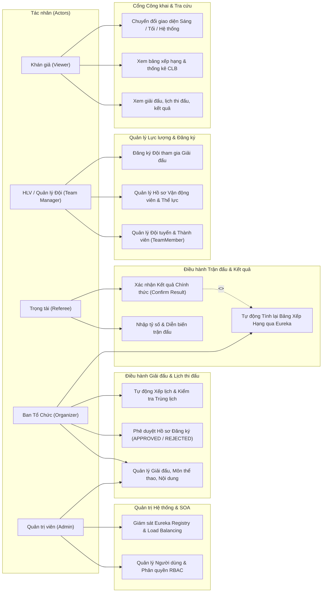

# 01. TỔNG QUAN HỆ THỐNG & PHÂN TÍCH YÊU CẦU (USE CASE DIAGRAM)

**Tên đề tài:** Xây dựng và phát triển hệ thống quản lý thi đấu thể thao theo kiến trúc hướng dịch vụ (Service-Oriented Architecture — SOA).

---

## 1. Tổng quan Hệ thống

Hệ thống Quản lý Thi đấu Thể thao (**VN Sports SOA**) là nền tảng quản trị giải đấu toàn diện được xây dựng theo **Kiến trúc Hướng Dịch vụ (SOA / Microservices)**. Hệ thống giải quyết bài toán tổ chức các giải đấu thể thao chuyên nghiệp và phong trào (tiêu biểu là Bóng đá V.League, Giải Sinh viên Toàn quốc, Futsal) từ khâu:
1. Khởi tạo môn thể thao, giải đấu, nội dung thi đấu và điều lệ.
2. Quản lý hồ sơ câu lạc bộ, huấn luyện viên, vận động viên và đăng ký tham dự giải.
3. Tự động lập lịch thi đấu theo thể thức (Vòng tròn, Chia bảng, Loại trực tiếp) kèm kiểm tra xung đột lịch (Sân, Trọng tài, Đội bóng).
4. Ghi nhận tỷ số, diễn biến trận đấu (Bàn thắng, Thẻ phạt) và xác nhận kết quả chính thức bởi Trọng tài.
5. Tự động tính toán và xếp hạng bảng tổng sắp thời gian thực (Điểm số $\rightarrow$ Hiệu số $\rightarrow$ Bàn thắng) cùng hệ thống thông báo sự kiện bất đồng bộ.

---

## 2. Phân tích Yêu cầu & Phân quyền 5 Vai trò (RBAC)

| Vai trò (Role) | Mã hệ thống | Quyền hạn nghiệp vụ chính |
|---|---|---|
| **Quản trị viên** | `ROLE_ADMIN` | Toàn quyền quản trị hệ thống, quản lý người dùng, cấp/đổi vai trò, giám sát 10 Microservices trên Eureka. |
| **Ban tổ chức** | `ROLE_ORGANIZER` | Tạo/sửa/xóa giải đấu, môn thể thao, duyệt đăng ký đội tuyển, tự động xếp lịch thi đấu, xuất báo cáo. |
| **Trọng tài** | `ROLE_REFEREE` | Cập nhật trạng thái trận đấu, nhập tỷ số, ghi nhận bàn thắng/thẻ phạt và xác nhận kết quả chính thức. |
| **Quản lý đội / HLV** | `ROLE_TEAM_MANAGER` | Quản lý thông tin CLB, thêm vận động viên vào đội hình, gửi hồ sơ đăng ký tham gia giải đấu. |
| **Khán giả** | `ROLE_VIEWER` | Tra cứu trang chủ công khai, danh sách giải đấu, lịch thi đấu, kết quả trực tuyến và bảng xếp hạng. |

---

## 3. Sơ đồ Ca sử dụng Tổng quát (Use Case Diagram)

