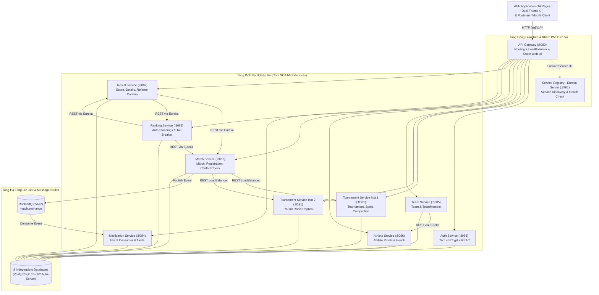
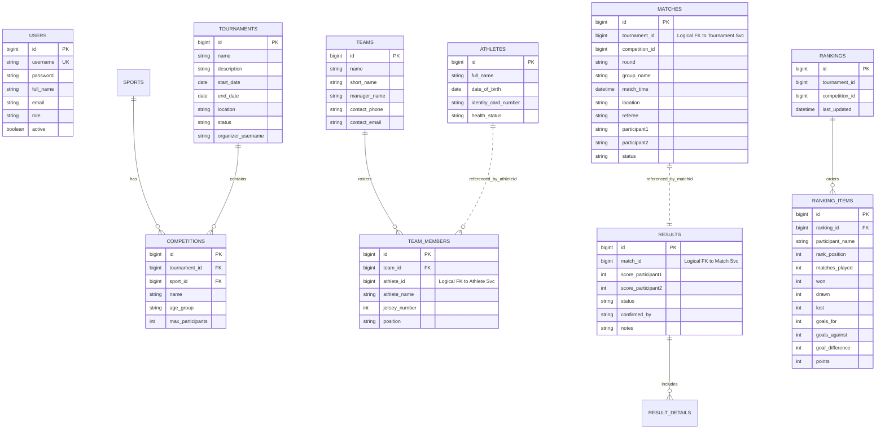
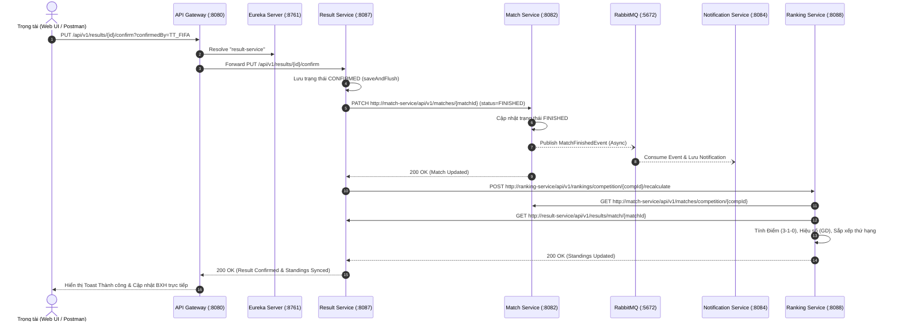

# 02. KIẾN TRÚC HƯỚNG DỊCH VỤ (SOA), ERD & SEQUENCE DIAGRAM

---

## 1. Kiến trúc Tổng thể 10 Microservices (SOA Architecture)

Hệ thống được thiết kế tuân thủ nghiêm ngặt các nguyên tắc **Service-Oriented Architecture (SOA)**:
- **Độc lập tiến trình & Cổng giao tiếp:** 10 dịch vụ chạy thành các tiến trình độc lập, giao tiếp qua RESTful API và Message Broker (RabbitMQ).
- **Database-per-Service:** 8 dịch vụ nghiệp vụ sở hữu 8 schema/database tách biệt (`auth_db`, `tournament_db`, `team_db`, `athlete_db`, `match_db`, `result_db`, `ranking_db`, `notification_db`). Không dịch vụ nào truy cập trực tiếp bảng dữ liệu của dịch vụ khác.
- **Service Registry & Discovery (Eureka `:8761`):** Không hardcode địa chỉ IP/Port; toàn bộ lời gọi liên dịch vụ sử dụng tên logic (`http://tournament-service`, `http://match-service`, `http://athlete-service`, `http://ranking-service`) qua `@LoadBalanced RestClient`.
- **Client-Side Load Balancing & Failover:** `tournament-service` vận hành đồng thời 2 instances (`:8081` và `:8091`), tự động chia tải Round-Robin và tự động chuyển đổi dự phòng (Failover) khi 1 instance gặp sự cố.

---

## 2. Sơ đồ Quan hệ Thực thể Liên Dịch vụ (ERD — Database-per-Service)

---

## 3. Biểu đồ Tuần tự (Sequence Diagram) — Luồng Trọng tài Xác nhận Kết quả & Tự động Cập nhật Bảng Xếp Hạng

