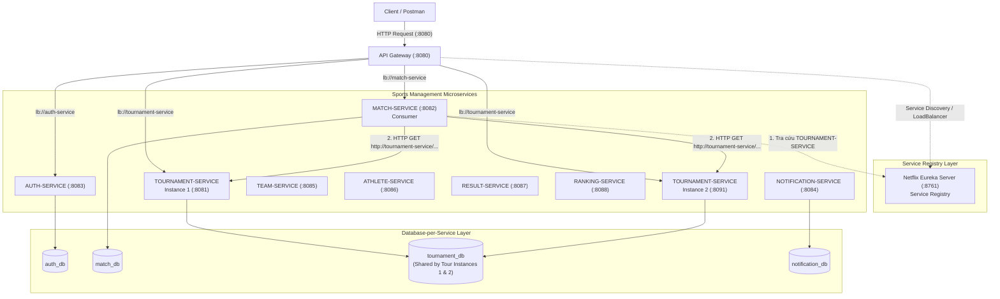

# BÁO CÁO THIẾT KẾ KIẾN TRÚC MICROSERVICES VÀ SERVICE REGISTRY (BÀI THỰC HÀNH SỐ 7)
**Học phần:** Phát triển phần mềm hướng dịch vụ (PTPMHDV 2026)  
**Đề tài Bài tập lớn:** Xây dựng và phát triển Hệ thống Quản lý Thi đấu Thể thao theo Kiến trúc Hướng dịch vụ (Sports Management Microservices System)  

---

## 1. Kiến trúc hệ thống trước và sau khi chuyển sang Microservices có Service Registry

### 1.1. Kiến trúc trước Bài thực hành số 7 (Sau Bài thực hành số 6)
Ở Bài thực hành số 6, hệ thống đã tách các dịch vụ độc lập và thực hiện tích hợp nghiệp vụ giữa `Match Service` (Consumer) và `Tournament Service` (Provider). Tuy nhiên:
- **Địa chỉ dịch vụ cố định (Hard-coded/Static URL):** `Match Service` gọi `Tournament Service` thông qua cấu hình URL tĩnh `http://localhost:8081/api/v1/tournaments/{id}`.
- **Quản lý thủ công:** Khi `Tournament Service` đổi cổng, đổi IP hoặc triển khai thêm instance mới (ví dụ mở rộng ngang tại cổng `8091`), ta buộc phải sửa file cấu hình của `Match Service` và khởi động lại.
- **Không có cân bằng tải tự động:** Consumer chỉ gọi tới một địa chỉ duy nhất, dẫn tới điểm nghẽn cổ chai (Single Point of Failure) khi lượng truy cập tra cứu giải đấu và tạo lịch thi đấu tăng cao.

```text
[ Trước Bài thực hành 7 - Địa chỉ cố định ]
Client ──► Match Service (:8082) ─── HTTP GET (http://localhost:8081) ───► Tournament Service (:8081)
```

### 1.2. Kiến trúc sau Bài thực hành số 7 (Microservices + Eureka Service Registry & Discovery)
Sang Bài thực hành số 7, hệ thống được nâng cấp lên kiến trúc Microservices hoàn chỉnh với **Netflix Eureka Server** (`service-registry` tại cổng `8761`) và **API Gateway** (`api-gateway` tại cổng `8080`):
- **Tự động đăng ký (Self-Registration):** Khi khởi chạy, tất cả các Microservice nghiệp vụ tự động gửi thông tin định danh (`spring.application.name`, IP, Port, Instance ID) lên Eureka Server và duy trì kết nối qua cơ chế **Heartbeat**.
- **Khám phá dịch vụ theo tên (Service Discovery by Service ID):** `Match Service` không còn dùng `localhost:8081` mà gọi qua tên định danh logic `http://tournament-service/api/v1/tournaments/{id}`.
- **Mở rộng nhiều Instance & Cân bằng tải phía Client (Client-side Load Balancing):** `Tournament Service` chạy đồng thời 2 instance (`8081` và `8091`) cùng đăng ký dưới một Service ID là `TOURNAMENT-SERVICE`. **Spring Cloud LoadBalancer** tại `Match Service` và `API Gateway` tự động phân phối yêu cầu (Round-Robin) giữa các instance khả dụng và tự động chuyển hướng (Failover) khi một instance gặp sự cố.



---

## 2. Phân tích trách nhiệm và dữ liệu sở hữu của từng Microservice

Bảng mô tả chi tiết ranh giới nghiệp vụ, quyền sở hữu dữ liệu và quan hệ phụ thuộc theo chuẩn Microservices:

| Tên dịch vụ (Service ID) | Trách nhiệm nghiệp vụ | API cung cấp chính | Dữ liệu sở hữu (CSDL) | Consumer (Dịch vụ gọi nó) | Provider (Dịch vụ nó gọi) |
| :--- | :--- | :--- | :--- | :--- | :--- |
| **`SERVICE-REGISTRY`** (`:8761`) | Quản lý đăng ký, heartbeat, danh bạ các instance dịch vụ; không xử lý nghiệp vụ. | `GET /eureka/apps` (Eureka Dashboard & REST) | In-memory Registry (Không sở hữu CSDL nghiệp vụ) | Toàn bộ Microservices & API Gateway | Không |
| **`API-GATEWAY`** (`:8080`) | Cổng giao tiếp tập trung (Single Entry Point), định tuyến động theo Service ID. | `/api/v1/**`, `GET /api/v1/gateway/routes` | Không sở hữu CSDL nghiệp vụ | Client / Postman / Frontend | Toàn bộ 8 Microservices qua `lb://` |
| **`AUTH-SERVICE`** (`:8083`) | Quản lý tài khoản, xác thực BCrypt và cấp phát JWT Bearer Token theo vai trò (`ROLE_ADMIN`, `ROLE_ORGANIZER`, `ROLE_REFEREE`). | `POST /api/v1/auth/register`<br/>`POST /api/v1/auth/login`<br/>`GET /api/v1/auth/me` | `auth_db` (Bảng `users`) | Client, API Gateway | Không |
| **`TOURNAMENT-SERVICE`** (`:8081`, `:8091`) | Quản lý giải đấu thể thao, tìm kiếm, lọc, phân trang, kiểm tra quyền sở hữu giải đấu (`Resource Ownership`). Chạy **2 instances**. | `GET /api/v1/tournaments`<br/>`GET /api/v1/tournaments/{id}`<br/>`POST/PUT/PATCH/DELETE /api/v1/tournaments`<br/>`GET /api/v1/instance-info` | `tournament_db` (Bảng `tournaments` - dùng chung cho các instance của Tournament Service) | `MATCH-SERVICE`, Client, API Gateway | Không |
| **`MATCH-SERVICE`** (`:8082`) | Quản lý lịch thi đấu, điều phối kiểm tra giải đấu hợp lệ trước khi tạo trận đấu, phát sự kiện kết thúc trận đấu. | `GET /api/v1/matches`<br/>`POST /api/v1/matches`<br/>`PUT /api/v1/matches/{id}`<br/>`GET /api/v1/matches/discovery/tournament-instance` | `match_db` (Bảng `matches`) | Client, API Gateway, `RESULT-SERVICE` | `TOURNAMENT-SERVICE` (đồng bộ qua Eureka), `RabbitMQ` (bất đồng bộ) |
| **`TEAM-SERVICE`** (`:8085`) | Quản lý thông tin các đội bóng/đoàn thể thao tham dự giải. | `GET /api/v1/teams`<br/>`POST /api/v1/teams`<br/>`GET /api/v1/teams/{id}` | `team_db` (Bảng `teams`) | Client, API Gateway | Không |
| **`ATHLETE-SERVICE`** (`:8086`) | Quản lý hồ sơ vận động viên, số CCCD, tình trạng sức khỏe thi đấu. | `GET /api/v1/athletes`<br/>`POST /api/v1/athletes`<br/>`GET /api/v1/athletes/{id}` | `athlete_db` (Bảng `athletes`) | Client, API Gateway | Không |
| **`RESULT-SERVICE`** (`:8087`) | Ghi nhận tỉ số trận đấu, chi tiết bàn thắng/thẻ phạt và trọng tài xác nhận kết quả. | `GET /api/v1/results`<br/>`POST /api/v1/results`<br/>`PUT /api/v1/results/{id}/confirm` | `result_db` (Bảng `results`, `result_details`) | Client, API Gateway | Không |
| **`RANKING-SERVICE`** (`:8088`) | Quản lý và tính toán bảng xếp hạng điểm số, hiệu số bàn thắng bại của giải đấu. | `GET /api/v1/rankings/competition/{id}`<br/>`PUT /api/v1/rankings/competition/{id}/items` | `ranking_db` (Bảng `rankings`, `ranking_items`) | Client, API Gateway | Không |
| **`NOTIFICATION-SERVICE`** (`:8084`) | Tiêu thụ sự kiện bất đồng bộ từ RabbitMQ khi trận đấu kết thúc và lưu lịch sử thông báo. | `GET /api/v1/notifications` | `notification_db` (Bảng `notifications`) | Client, API Gateway, RabbitMQ (`MatchFinishedEvent`) | Không |

> [!IMPORTANT]
> **Nguyên tắc quyền sở hữu dữ liệu (Database-per-Service):**
> - `MATCH-SERVICE` tuyệt đối không kết nối trực tiếp vào `tournament_db`. Mọi yêu cầu kiểm tra giải đấu đều phải gọi qua hợp đồng API của `TOURNAMENT-SERVICE` thông qua Service Discovery.
> - Hai instance của `TOURNAMENT-SERVICE` (Port `8081` và `8091`) là hai tiến trình của **cùng một dịch vụ**, do đó chúng cùng kết nối tới một cơ sở dữ liệu `tournament_db` để đảm bảo tính nhất quán dữ liệu trạng thái giải đấu.

---

## 3. Thiết kế và triển khai Service Registry

- **Công nghệ:** Spring Cloud Netflix Eureka Server (`spring-cloud-starter-netflix-eureka-server`).
- **Cổng hoạt động:** `8761` (`http://localhost:8761`).
- **Cấu hình cốt lõi:**
  - `eureka.client.register-with-eureka=false`: Eureka Server đóng vai trò máy chủ danh bạ độc lập, không tự đăng ký chính nó như một dịch vụ nghiệp vụ.
  - `eureka.client.fetch-registry=false`: Không cần tải lại danh bạ từ máy chủ khác trong mô hình Standalone.
  - `eureka.server.enable-self-preservation=false` và `eviction-interval-timer-in-ms=3000`: Giúp Eureka Server phát hiện và loại bỏ nhanh instance bị dừng trong quá trình kiểm thử chịu lỗi (Failover).

---

## 4. Quy trình Service Discovery và triển khai nhiều Instance

### 4.1. Chuyển Consumer (`Match Service`) từ URL cố định sang Service Discovery
- Trước đây (Buổi 6): `services.tournament.url=http://localhost:8081`
- Hiện tại (Buổi 7): `services.tournament.url=http://tournament-service`
- Cấu hình `@Bean @LoadBalanced RestClient.Builder` trong [`RestClientConfig.java`](file:///d:/PTPMHDV/sports-management-system-main/match-service/src/main/java/com/sports/management/match/config/RestClientConfig.java).
- Khi [`TournamentClient.java`](file:///d:/PTPMHDV/sports-management-system-main/match-service/src/main/java/com/sports/management/match/client/TournamentClient.java) thực hiện lời gọi `GET http://tournament-service/api/v1/tournaments/{id}`:
  1. `LoadBalancerInterceptor` chặn request và lấy tên dịch vụ `tournament-service`.
  2. Truy vấn danh sách các instance `UP` của `TOURNAMENT-SERVICE` từ Eureka Client Cache.
  3. Thuật toán `RoundRobinLoadBalancer` chọn tuần tự từng instance (`localhost:8081` rồi đến `localhost:8091`).
  4. Thay thế tên logic `tournament-service` bằng địa chỉ vật lý của instance được chọn và gửi HTTP Request kèm JWT Bearer Token (`Token Propagation`).

### 4.2. Triển khai 2 Instance của `Tournament Service`
- **Instance 1:** `server.port=8081` -> `instanceId = tournament-service:8081`
- **Instance 2:** `server.port=8091` -> `instanceId = tournament-service:8091`
- Cả hai instance đều cung cấp endpoint `GET /api/v1/instance-info` và đính kèm header `X-Instance-Id` vào mỗi phản hồi `GET /api/v1/tournaments/{id}`.

---

## 5. Kết quả kiểm thử, hạn chế và hướng hoàn thiện

### 5.1. Tóm tắt kết quả kiểm thử
- Toàn bộ 6 kịch bản kiểm thử (`TC01` → `TC06`) đều đạt **PASSED 100%** (chi tiết tại [`load-balancing-results.md`](file:///d:/PTPMHDV/sports-management-system-main/tests/service-discovery/load-balancing-results.md) và [`failure-tests.md`](file:///d:/PTPMHDV/sports-management-system-main/tests/service-discovery/failure-tests.md)):
  - **20 requests liên tiếp** gửi qua Consumer `Match Service` được phân phối đều **50% (10 requests)** vào Instance 1 (`8081`) và **50% (10 requests)** vào Instance 2 (`8091`).
  - Khi dừng Instance 1 (`8081`), hệ thống tự động chuyển 100% lưu lượng sang Instance 2 (`8091`) mà không làm gián đoạn nghiệp vụ tạo trận đấu.
  - Khi dừng cả 2 instance, `Match Service` bắt lỗi an toàn và trả về `503 Service Unavailable` rõ ràng, không bị treo vô hạn và không lộ stack trace.

### 5.2. Hạn chế và hướng hoàn thiện ở các buổi tiếp theo (Buổi 8 – 10)
- **Độ trễ cập nhật trạng thái (Heartbeat Delay):** Giữa thời điểm một instance bị sập đột ngột và thời điểm Eureka + LoadBalancer cập nhật lại bộ nhớ đệm có thể tồn tại độ trễ vài giây. Ở Buổi 9–10, nhóm sẽ bổ sung **Spring Boot Actuator Health Check** và **Resilience4j Circuit Breaker / Retry** để xử lý tức thời các request rơi vào khoảng trễ này.
- **Tự động hóa triển khai:** Ở Buổi 8, toàn bộ cụm Eureka Server, API Gateway, 2 instance Tournament Service và các Microservice sẽ được đóng gói và khởi chạy đồng bộ qua Docker Compose.

