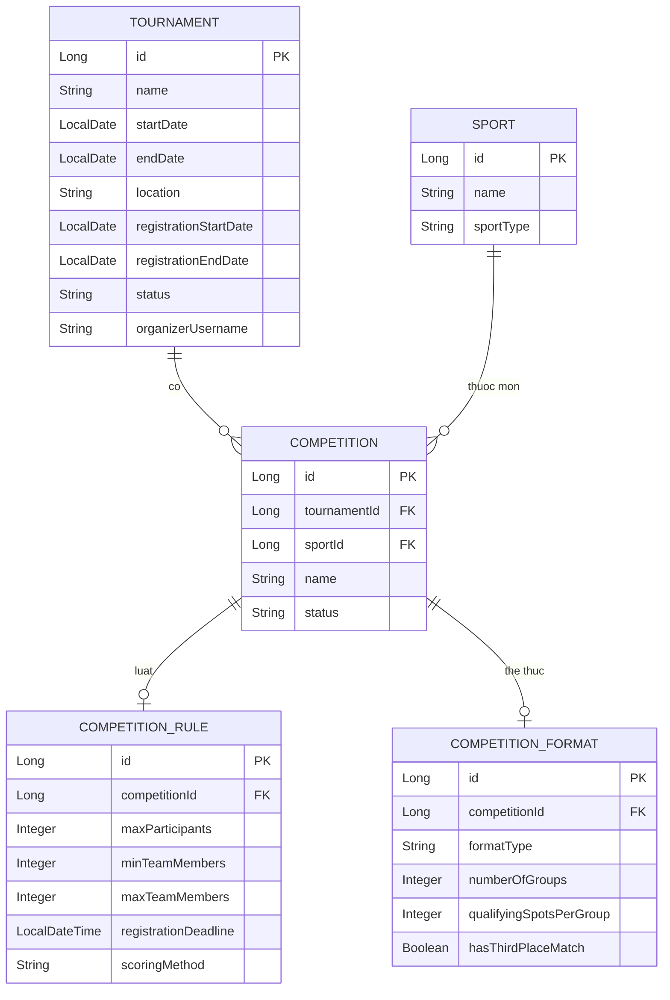
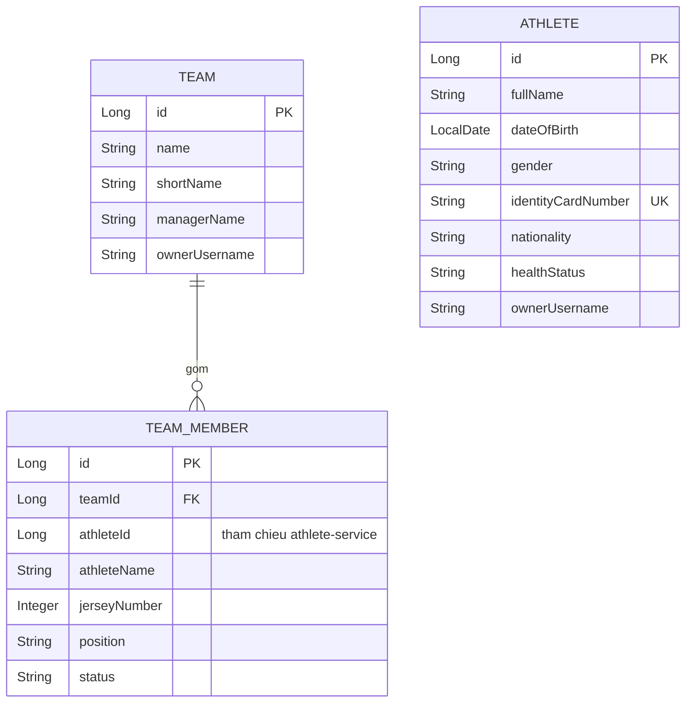
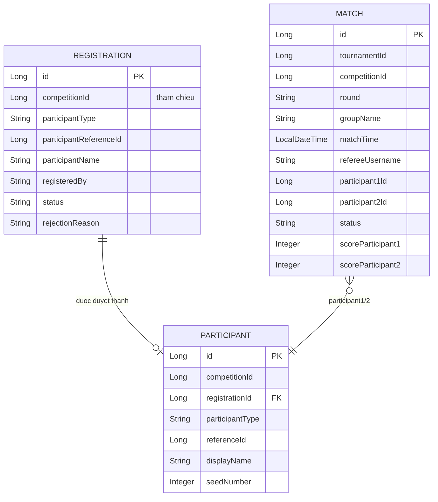
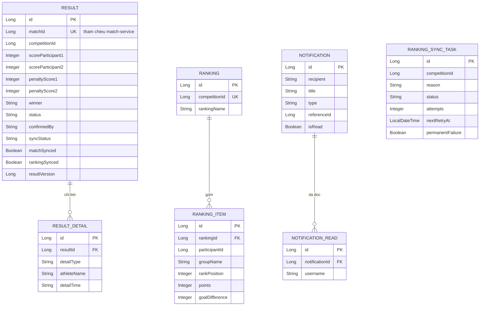
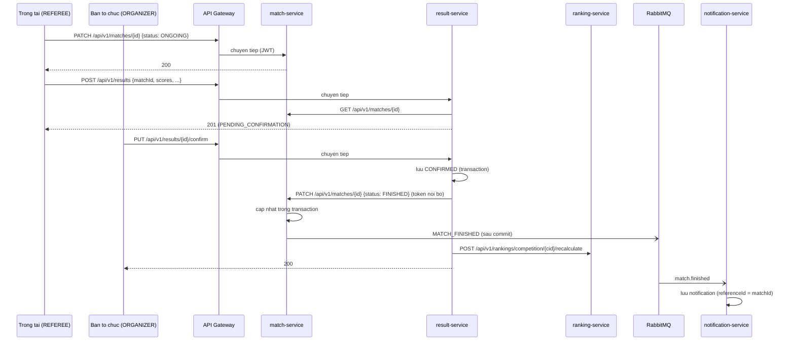

# Thiết kế dữ liệu và kết nối service (TH4)

## 1. Danh sách service

| Service | Cổng | Trách nhiệm |
|---|---|---|
| service-registry (Eureka) | 8761 | Đăng ký và khám phá service |
| api-gateway | 8080 | Điểm vào duy nhất, kiểm tra JWT, định tuyến theo Service ID |
| auth-service | 8083 | Tài khoản, đăng nhập, phát hành JWT |
| tournament-service (2 instance) | 8081/8091 | Giải đấu, môn thi, nội dung thi, luật, thể thức |
| team-service | 8085 | Đội và thành viên đội |
| athlete-service | 8086 | Hồ sơ vận động viên |
| match-service | 8082 | Đăng ký tham gia, danh sách tham dự, lịch thi đấu, trận đấu; phát sự kiện `MATCH_FINISHED` |
| result-service | 8087 | Kết quả, chi tiết kết quả, xác nhận và đồng bộ |
| ranking-service | 8088 | Bảng xếp hạng theo nội dung thi |
| notification-service | 8084 | Nhận sự kiện từ RabbitMQ, lưu và trả thông báo |

## 2. Database per service

Mỗi service nghiệp vụ có database PostgreSQL riêng và **tài khoản DB riêng** chỉ có quyền trên database đó (`docker/create-service-db-users.sh`). Không service nào đọc trực tiếp bảng của service khác.

| Database | Chủ sở hữu | Bảng chính |
|---|---|---|
| `auth_db` | auth-service | `users` |
| `tournament_db` | tournament-service (cả 2 instance dùng chung vì là cùng một service) | `tournaments`, `sports`, `competitions`, `competition_rules`, `competition_formats` |
| `team_db` | team-service | `teams`, `team_members` |
| `athlete_db` | athlete-service | `athletes` |
| `match_db` | match-service | `matches`, `registrations`, `participants` |
| `result_db` | result-service | `results`, `result_details`, `ranking_sync_tasks` |
| `ranking_db` | ranking-service | `rankings`, `ranking_items` |
| `notification_db` | notification-service | `notifications`, `notification_reads` |

Khi chạy không có Docker, mỗi service dùng tệp H2 riêng (`logs/h2_<service>_db`, chế độ PostgreSQL), vẫn giữ nguyên nguyên tắc tách dữ liệu.

## 3. Thực thể và quyền sở hữu dữ liệu

Tham chiếu sang service khác chỉ lưu **mã định danh** (và khi cần hiển thị thì lưu thêm bản sao tên), không có khóa ngoại xuyên database.

| Dữ liệu | Service sở hữu | Service khác tham chiếu bằng |
|---|---|---|
| Giải đấu, nội dung thi | tournament-service | `tournamentId`, `competitionId` trong `matches`, `registrations`, `results`, `rankings` |
| Vận động viên | athlete-service | `athleteId` + `athleteName` trong `team_members`; `participantReferenceId` trong `registrations`, `referenceId` trong `participants` |
| Đội | team-service | `participantReferenceId` (loại TEAM) trong `registrations`; `referenceId` (loại TEAM) trong `participants` |
| Trận đấu | match-service | `matchId` trong `results`; `referenceId` trong `notifications` |
| Kết quả | result-service | `ranking-service` (tính lại BXH) và `match-service` (`generate-next-round`) đọc qua API |
| Người dùng | auth-service | `username` trong `organizerUsername`, `ownerUsername`, `refereeUsername`, `registeredBy`, `recipient` |

## 4. Sơ đồ dữ liệu theo service

(`RESULT`/`RESULT_DETAIL`/`RANKING_SYNC_TASK` thuộc `result_db`; `RANKING`/`RANKING_ITEM` thuộc `ranking_db`; `NOTIFICATION`/`NOTIFICATION_READ` thuộc `notification_db`.)

## 5. API chính

Bảng đầy đủ: `docs/03-API-DOCS-CAI-DAT-DEMO-KIEM-THU.md`; quy ước thiết kế: `docs/rest-api-design.md`.

## 6. Giao tiếp giữa các service

Đồng bộ dùng `RestClient` `@LoadBalanced` gọi theo Service ID qua Eureka (timeout kết nối 2 s, đọc 10 s, chuyển tiếp `X-Request-Id`). Bất đồng bộ dùng RabbitMQ.

| Gọi từ | Gọi đến | API | Mục đích |
|---|---|---|---|
| match-service | tournament-service | `GET /tournaments/{id}`, `GET /competitions/{id}`, `/format`, `/rule`, `?tournamentId=`, `GET /sports/{id}` | Kiểm tra giải đấu, nội dung thi, môn thi, luật và thể thức khi đăng ký và xếp lịch |
| match-service | team-service | `GET /teams/{id}`, `GET /teams/{id}/members` | Kiểm tra đội tuyển và thành viên đủ điều kiện khi đăng ký / duyệt |
| match-service | athlete-service | `GET /athletes/{id}` | Kiểm tra vận động viên và tình trạng sức khỏe khi đăng ký / duyệt |
| match-service | result-service | `GET /results/by-matches?matchIds=` | Đọc kết quả `CONFIRMED` để xác định đội thắng khi tạo vòng loại trực tiếp tiếp theo (`generate-next-round`) |
| tournament-service | match-service | `GET /matches/tournament/{id}`, `GET /matches/competition/{id}`, `GET /registrations/competition/{id}` | Tổng hợp dashboard giải đấu và chặn xóa/sửa khi đã có đăng ký hoặc trận đấu |
| tournament-service | ranking-service | `GET /rankings` | Tổng hợp số bảng xếp hạng trên dashboard giải đấu |
| team-service | athlete-service | `GET /athletes/{id}` | Kiểm tra vận động viên khi thêm vào đội |
| team-service | match-service | `GET /participants/usage`, `GET /registrations/teams/{id}/roster-change-validation` | Chặn xóa đội đang tham gia giải và kiểm tra ràng buộc đội hình khi đội đang đăng ký |
| athlete-service | team-service | `GET /teams/athletes/{id}/usage` | Chặn xóa VĐV đang thuộc đội |
| athlete-service | match-service | `GET /participants/usage` | Chặn xóa VĐV đang có đăng ký hoặc tham gia thi đấu |
| result-service | match-service | `GET /matches/{id}`, `GET /matches/competition/{id}`, `PATCH /matches/{id}` (token nội bộ) | Kiểm tra trận, kiểm tra tiến trình knockout, chuyển trận sang `FINISHED` kèm tỉ số khi xác nhận kết quả |
| result-service | tournament-service | `GET /tournaments/{id}`, `GET /competitions/{id}/format` | Kiểm tra quyền sở hữu giải đấu và thể thức (`KNOCKOUT` yêu cầu luân lưu khi hòa) |
| result-service | ranking-service | `POST /rankings/competition/{id}/recalculate` | Yêu cầu tính lại bảng xếp hạng (bỏ qua nếu thể thức `KNOCKOUT`) |
| ranking-service | tournament/match/result-service | `GET /tournaments/{id}`, `GET /competitions/{id}`, `/format`, `GET /matches/competition/{id}`, `GET /results/by-matches?matchIds=` | Lấy dữ liệu giải đấu, trận và kết quả để tính điểm |
| match-service | notification-service | RabbitMQ `sports.exchange`, routing key `match.finished` | Sự kiện `MATCH_FINISHED`, phát **sau khi commit** |

## 7. Sequence diagram — xác nhận kết quả trận đấu

Nếu `ranking-service` không phản hồi, `result-service` đánh dấu `Result.syncStatus = FAILED` kèm `nextRetryAt`, trả HTTP `202 Accepted` và để `ResultSyncRecoveryWorker` tự thử lại định kỳ, không làm hỏng việc xác nhận (còn bảng `ranking_sync_tasks` dùng khi sửa, mở lại hoặc xóa kết quả đã đồng bộ BXH).

## 8. Luồng nghiệp vụ hoàn chỉnh

1. ORGANIZER tạo giải đấu, nội dung thi, luật và thể thức (tournament-service).
2. TEAM_MANAGER tạo vận động viên (athlete-service), đội và thành viên (team-service).
3. TEAM_MANAGER đăng ký đội/VĐV vào nội dung thi; match-service kiểm tra với tournament-service và athlete-service.
4. ORGANIZER duyệt đăng ký → tạo `participants`, xếp lịch trận đấu, phân công trọng tài.
5. REFEREE bắt đầu trận (ONGOING) và ghi kết quả; ORGANIZER xác nhận.
6. result-service chuyển trận sang FINISHED, yêu cầu ranking-service tính lại bảng xếp hạng.
7. match-service phát `MATCH_FINISHED`; notification-service tạo thông báo; người dùng xem kết quả, bảng xếp hạng và thông báo.

## 9. Transaction và rollback

- Thao tác ghi trong từng service dùng `@Transactional` (ví dụ `ResultPersistenceService`, `MatchService`, `RegistrationService`, `TeamService`): lỗi giữa chừng làm toàn bộ thay đổi trong database của service đó được rollback.
- Không dùng transaction phân tán. Nhất quán giữa các service đạt được bằng trạng thái đồng bộ (`syncStatus`, `matchSynced`, `rankingSynced`, `resultVersion`) và thử lại có giới hạn.
- Sự kiện RabbitMQ chỉ được gửi **sau khi commit**; nếu transaction rollback thì không có sự kiện. Bằng chứng: `match-service/src/test/java/com/sports/management/match/RabbitMQContractAndAfterCommitTest.java`, ca `finishMatch_publishesToSportsExchangeAfterCommitAndNotBeforeOrOnRollback`.

## 10. Các trường hợp lỗi

| Tình huống | Kết quả |
|---|---|
| Đăng ký vào nội dung thi không tồn tại | `tournament-service` trả 404 → `match-service` ném `ResourceNotFoundException` và trả **404**, không tạo đăng ký |
| `tournament-service` tắt khi đăng ký | Không có instance trên Eureka / Connection Refused (hoặc hết timeout 2s/10s) → `match-service` trả **503**, không ghi dữ liệu |
| Ghi kết quả cho trận chưa ONGOING hoặc không tồn tại | Trận không tồn tại → **404**; trận có trạng thái khác `ONGOING`/`FINISHED` hoặc chưa tới giờ thi đấu → **400** |
| Ghi kết quả lần hai cho cùng trận (`POST /api/v1/results`) | Nếu bản ghi đang `PENDING_CONFIRMATION` (hoặc `ORGANIZER`/`ADMIN` sửa lại chưa có vòng knockout tiếp theo) → **201** (ghi đè cập nhật bản ghi và tăng `resultVersion`); nếu kết quả đã `CONFIRMED` mà `ROLE_REFEREE` gửi lại → **403**; nếu `KNOCKOUT` đã tạo trận vòng sau → **409** |
| Xóa hoặc sửa trận đã `FINISHED` | `DELETE /matches/{id}` khi trận `ONGOING`/`FINISHED` → **409**; `PUT`/`PATCH` sửa trường cố định (đội, giờ, sân) hoặc đổi trạng thái khỏi `FINISHED` → **400** (`ROLE_REFEREE` sửa trận `FINISHED` → **403**) |
| Xóa VĐV đang thuộc đội hoặc đang tham gia | **409** (`team-service`/`match-service` tắt → **503**) |
| `ranking-service` tắt khi xác nhận kết quả | Xác nhận vẫn thành công (**202 Accepted**), trận đã chuyển `FINISHED`; `Result` lưu `syncStatus=FAILED` và `nextRetryAt` để `ResultSyncRecoveryWorker` tự thử lại (riêng sửa/mở lại/xóa kết quả đã đồng bộ BXH tạo bản ghi trong `ranking_sync_tasks`) |
| RabbitMQ tạm ngừng | `MatchEventProducer` ghi log cảnh báo và bỏ qua phát sự kiện; trận đấu đã `FINISHED` không bị rollback |
