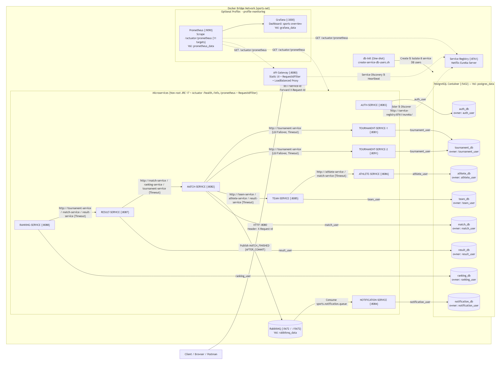

# THIẾT KẾ TRIỂN KHAI HỆ THỐNG BẰNG DOCKER COMPOSE (BÀI THỰC HÀNH 8)

**Hệ thống:** Quản lý Thi đấu Thể thao đa môn (Sports Management System)  
**Nền tảng:** Spring Boot 4.1.1, Java 17 (Eclipse Temurin Alpine), Spring Cloud 2025.1.4 (Netflix Eureka + LoadBalancer), PostgreSQL 17, RabbitMQ Management, Docker & Docker Compose.

---

## 1. Mục tiêu kiến trúc triển khai

Chuyển hệ thống 10 module từ môi trường chạy thử cục bộ sang cụm container độc lập hoàn toàn với đường dẫn JDK/Maven hoặc file riêng trên máy lập trình viên:
- Đóng gói bằng **Docker multi-stage build** (`maven:3.9-eclipse-temurin-17-alpine` -> `eclipse-temurin:17-jre-alpine`), chạy dưới user non-root `appuser`.
- Toàn bộ giao tiếp nội bộ đi qua mạng bridge `sports-net` bằng **Docker DNS** (`postgres-db`, `rabbitmq`, `service-registry`) và **Eureka Service ID** (`http://tournament-service`, `http://match-service`, ...); không dùng `localhost` giữa các container.
- Quản lý dữ liệu theo nguyên tắc **Database-per-Service** trong PostgreSQL với persistent named volume `postgres_data` và `rabbitmq_data`.

*(Nguồn sơ đồ chỉnh sửa được lưu tại [`deployment-architecture.mmd`](deployment-architecture.mmd).)*

---

## 2. Rà soát và phân công 10 module Microservices

| STT | Service (Module) | Chức năng chính | Database sở hữu | Gọi service nào (Consumer) | Được service nào gọi (Provider) | Số instance |
| :-: |---|---|---|---|---| :-: |
| 1 | `service-registry` | Máy chủ Netflix Eureka Server quản lý danh bạ instance và heartbeat (`8761`) | Không | Không (chỉ nhận đăng ký/truy vấn registry) | `api-gateway` và toàn bộ 8 business service (9 container nghiệp vụ) | `1` |
| 2 | `api-gateway` | Điểm truy cập duy nhất (Single Entry Point), phục vụ Web SPA, giới hạn CORS, định tuyến động `lb://service-id` và xuất báo cáo tổng hợp (`8080`) | Không (Stateless) | Gọi toàn bộ 8 business service (`auth`, `tournament`, `team`, `athlete`, `match`, `result`, `ranking`, `notification`) qua Eureka Service ID | Client / Browser / Postman / Script kiểm thử | `1` |
| 3 | `auth-service` | Đăng ký, đăng nhập BCrypt, chuẩn hóa username duy nhất không phân biệt hoa/thường/khoảng trắng, quản trị role/khóa tài khoản, cấp JWT HS256 (`8083`) | `auth_db` | `service-registry` (Eureka) | `api-gateway`, Client (qua Gateway) | `1` |
| 4 | `tournament-service` | Quản lý môn thể thao, giải đấu, nội dung thi đấu, điều lệ (`CompetitionRule`) và thể thức (`CompetitionFormat`); khóa sửa đổi khi đã phát sinh đăng ký/trận đấu (`8081`, `8091`) | `tournament_db` *(dùng chung cho cả 2 instance)* | `match-service` (kiểm tra ràng buộc xóa/sửa giải đấu và nội dung), `ranking-service` (kiểm tra BXH trước khi xóa giải), `service-registry` | `api-gateway`, `match-service`, `result-service`, `ranking-service` | **`2`** *(Cân bằng tải & Failover)* |
| 5 | `team-service` | Quản lý đội tuyển/CLB và danh sách thành viên đội; kiểm tra quyền sở hữu đội/VĐV và điều kiện đội hình trước khi thêm/xóa thành viên (`8085`) | `team_db` | `athlete-service` (xác minh VĐV tồn tại, quyền sở hữu, `QUALIFIED`), `match-service` (kiểm tra trùng VĐV giữa các đội `PENDING`/`APPROVED` & giới hạn thành viên theo điều lệ) | `api-gateway`, `match-service`, `athlete-service` (kiểm tra sử dụng trước khi xóa VĐV) | `1` |
| 6 | `athlete-service` | Quản lý hồ sơ VĐV (CCCD duy nhất, tình trạng sức khỏe `QUALIFIED`/`INJURED`/`SUSPENDED`), che giấu PII với người không có quyền (`8086`) | `athlete_db` | `team-service`, `match-service` (kiểm tra VĐV còn nằm trong đội/trận trước khi cho xóa) | `api-gateway`, `team-service`, `match-service` | `1` |
| 7 | `match-service` | Quản lý đăng ký thi đấu (`register`, `approve` kèm tái kiểm tra sức khỏe/đội hình), `Participant`, tự động xếp lịch (`KNOCKOUT`/`ROUND_ROBIN`/`GROUP_STAGE`), kiểm tra trùng lịch 120 phút, phát sự kiện RabbitMQ `MATCH_FINISHED` sau commit (`8082`) | `match_db` | `tournament-service` (LB qua 2 instance), `team-service`, `athlete-service`, `result-service` (knockout progression), `rabbitmq` (publish event) | `api-gateway`, `tournament-service`, `team-service`, `athlete-service`, `result-service`, `ranking-service` | `1` |
| 8 | `result-service` | Ghi nháp (`PENDING_CONFIRMATION`) và xác nhận (`CONFIRMED`) kết quả trận đấu (kiểm tra trạng thái hợp lệ/chặn trận `CANCELLED`), lưu tác vụ `RankingSyncTask` & cơ chế tự đồng bộ lại (`8087`) | `result_db` | `match-service` (xác minh trận & chuyển trạng thái `FINISHED`), `tournament-service`, `ranking-service` (tính lại BXH) | `api-gateway`, `match-service`, `ranking-service` | `1` |
| 9 | `ranking-service` | Tính và lưu BXH (`ROUND_ROBIN` / `GROUP_STAGE`), lọc thứ hạng, hỗ trợ làm mới từ kết quả đã xác nhận (`8088`) | `ranking_db` | `tournament-service`, `match-service`, `result-service` | `api-gateway`, `result-service`, `tournament-service` | `1` |
| 10 | `notification-service` | Lắng nghe queue RabbitMQ `sports.notification.queue`, chống trùng theo `matchId`, phân quyền xem thông báo công khai `ALL_USERS` vs riêng tư và lưu trạng thái đã đọc theo từng user (`8084`) | `notification_db` | `rabbitmq` (consume), `service-registry` | `api-gateway`, `RabbitMQ Broker` | `1` |

---

## 3. Lý do thiết kế nhiều instance và tách dữ liệu

### 3.1. `tournament-service` chạy 2 instance (`8081` & `8091`)
- Trong luồng thể thao, `tournament-service` là Provider trung tâm cung cấp metadata giải đấu, nội dung, thể thức và điều lệ cho `api-gateway`, `match-service`, `result-service` và `ranking-service`.
- Hai container `tournament-service` (`EUREKA_INSTANCE_ID=tournament-service:8081`) và `tournament-service-2` (`EUREKA_INSTANCE_ID=tournament-service:8091`) được build từ **cùng Dockerfile/mã nguồn**, đăng ký **cùng Service ID `TOURNAMENT-SERVICE`** trên Eureka Server, nhưng có **Instance ID khác nhau** để minh họa Round-Robin Load Balancing (Spring Cloud LoadBalancer) và khả năng chịu lỗi Failover khi một instance dừng.
- Cả hai instance kết nối tới **cùng database `tournament_db`** trong container `postgres-db` để đảm bảo trạng thái giải đấu, luật và nội dung luôn nhất quán giữa hai instance.

### 3.2. Database-per-Service trên PostgreSQL & Độ bền dữ liệu hạ tầng
- Hệ thống sử dụng **1 PostgreSQL 17 container (`postgres-db`)** chứa **8 database tách biệt** (`auth_db`, `tournament_db`, `team_db`, `athlete_db`, `match_db`, `result_db`, `ranking_db`, `notification_db`), được khởi tạo qua [`docker/init-multiple-dbs.sql`](../../docker/init-multiple-dbs.sql) dưới tài khoản `POSTGRES_USER` (`${DB_USERNAME:-sports}`), sau đó container một lần `db-init` ([`docker/create-service-db-users.sh`](../../docker/create-service-db-users.sh)) tạo 8 tài khoản riêng `<service>_user`, chuyển quyền sở hữu database/schema/bảng tương ứng và thu hồi quyền `CONNECT` từ `PUBLIC`.
- Mỗi business service chỉ được cấu hình `SPRING_DATASOURCE_URL` trỏ tới đúng database của mình; không có service nào truy vấn chéo database của service khác mà mọi tương tác liên service đi qua REST API (qua Eureka Service ID) hoặc message broker RabbitMQ.
- File [`docker-compose.yml`](../../docker-compose.yml) thống nhất `name: sports-management-system` (có thể override bằng `-p` khi chạy cách ly) và cấu hình `hostname: rabbitmq` để giữ cố định Erlang node name (`rabbit@rabbitmq`). Dữ liệu PostgreSQL và RabbitMQ được gắn named volume `postgres_data` và `rabbitmq_data` nên được bảo toàn khi restart container hoặc chạy `docker compose down && docker compose up -d`.

---

## 4. Cổng nội bộ, cổng publish, Actuator và Log

### 4.1. Phân biệt cổng nội bộ và cổng publish
- **Cổng nội bộ trong `sports-net`:** Các container giao tiếp trực tiếp qua DNS tên service Compose (như `postgres-db:5432`, `rabbitmq:5672`, `service-registry:8761`) hoặc qua Service ID trên Eureka (`http://tournament-service` trỏ tới `:8081` / `:8091`).
- **Cổng publish ra máy chủ (cấu hình qua `.env`):** Mặc định map `8080` (`api-gateway`), `8761` (`service-registry`), `8081`/`8091` (`tournament-service`), `8082` (`match-service`), `8083` (`auth-service`), `8084` (`notification-service`), `8085` (`team-service`), `8086` (`athlete-service`), `8087` (`result-service`), `8088` (`ranking-service`), `5432` (`postgres-db`), `5672`/`15672` (`rabbitmq`). Khi cần chạy song song nhiều cụm trên cùng máy, chỉ cần thay đổi biến port trong file `.env` và tên project Compose (`-p`) mà không sửa mã nguồn.

### 4.2. Thứ tự khởi động & Healthcheck
- Tầng hạ tầng & Registry (`postgres-db`, `rabbitmq`, `service-registry`) khởi động trước kèm healthcheck thực chất (`pg_isready`, `rabbitmq-diagnostics -q ping`, `wget /actuator/health`).
- Tầng business service dùng `depends_on` với `condition: service_healthy` trỏ tới `postgres-db`, `service-registry` (và thêm `rabbitmq` với `match-service`, `notification-service`), tránh vòng phụ thuộc.
- `api-gateway` phụ thuộc `service-registry: service_healthy` và tự động cập nhật danh sách backend từ Eureka mỗi 3 giây (`registry-fetch-interval-seconds=3`).

### 4.3. Timeout và retry có giới hạn cho lời gọi liên dịch vụ
- `RestClientConfig` của 6 service gọi sang service khác (`tournament`, `team`, `athlete`, `match`, `result`, `ranking`) đặt connect timeout `2s` và read timeout `10s`, chỉnh qua `SERVICES_CONNECT_TIMEOUT_MS` / `SERVICES_READ_TIMEOUT_MS` trong `.env`. Provider bị treo sẽ khiến consumer trả `503` sau tối đa khoảng thời gian này thay vì chờ vô hạn.
- Retry có giới hạn: các client thử lại tối đa 2 lần; `ResultSyncRecoveryWorker` thử lại tối đa 5 lần với khoảng chờ tăng dần. `api-gateway` chưa áp dụng timeout này.

### 4.4. Cô lập dữ liệu, mã theo dõi và giám sát
- Mỗi service kết nối bằng tài khoản PostgreSQL riêng (`<service>_user`) chỉ có quyền trên database của mình; container `db-init` thiết lập việc này trước khi các service khởi động (`depends_on: service_completed_successfully`).
- Mọi request mang `X-Request-Id` do `api-gateway` sinh, xuất hiện trong log của mọi service mà request đi qua.
- Profile Compose `monitoring` bổ sung Prometheus và Grafana, thu số liệu từ `/actuator/prometheus`.

### 4.5. Actuator & Logback
- Cả 10 module đều tích hợp `spring-boot-starter-actuator` + `micrometer-registry-prometheus`, chỉ expose `health,info,prometheus` và đặt `management.endpoint.health.show-details=never` để không lộ chi tiết hệ thống ra ngoài.
- Các lớp `SecurityConfig` chỉ mở `GET /actuator/health`, `/actuator/health/**`, `/actuator/info`, `/actuator/prometheus` phục vụ Docker healthcheck và giám sát Prometheus, giữ nguyên khóa toàn bộ các endpoint nhạy cảm (`/actuator/env`, ...) và các API quản trị/nghiệp vụ đang bảo vệ.
- `service-registry` và `api-gateway` không khai báo dependency JPA/RabbitMQ nên Actuator `/actuator/health` trả `UP` mà không bị báo `DOWN` giả do thành phần không dùng; 8 business service vẫn giữ nguyên health indicator của PostgreSQL (và RabbitMQ ở `match-service`, `notification-service`) để phản ánh đúng trạng thái kết nối thực tế.
- Toàn bộ log sử dụng SLF4J/Logback xuất ra stdout/console (theo chuẩn Spring Boot `[service-name]` kèm timestamp múi giờ `Asia/Ho_Chi_Minh` và nguyên nhân lỗi), không ghi JWT, mật khẩu hay CCCD vào log.
