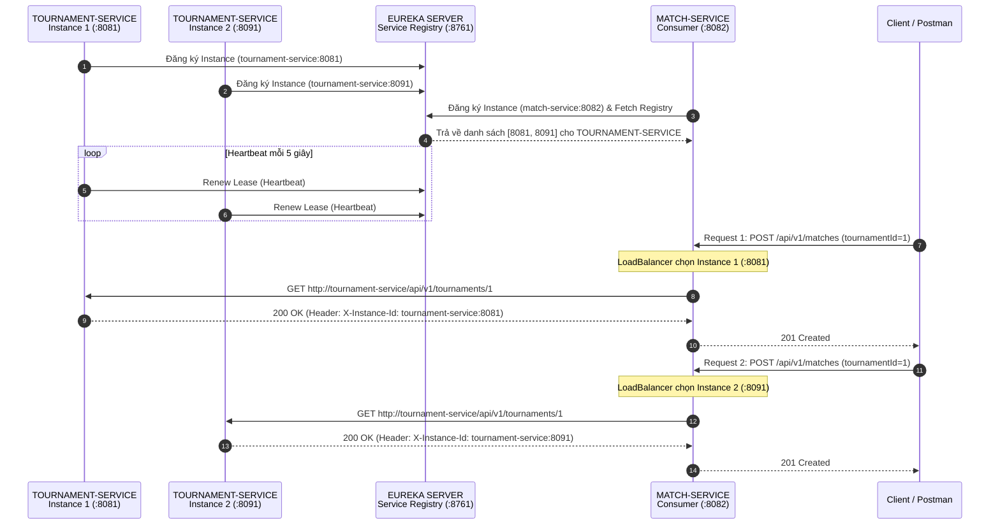

# THIẾT KẾ VÀ CẤU HÌNH SERVICE REGISTRY VỚI NETFLIX EUREKA (THỰC HÀNH 7)

## 1. Vai trò của Service Registry trong Hệ thống Quản lý Thi đấu Thể thao

Trong kiến trúc Microservices của hệ thống Quản lý Thi đấu Thể thao, **Service Registry (`service-registry` - Netflix Eureka Server)** đóng vai trò là "danh bạ trung tâm" quản lý vòng đời và địa chỉ mạng của toàn bộ các dịch vụ:

1. **Loại bỏ sự phụ thuộc vào IP/Port cố định:** Các dịch vụ Consumer (`match-service`, `api-gateway`) chỉ cần biết tên định danh (`TOURNAMENT-SERVICE`, `AUTH-SERVICE`, ...) thay vì địa chỉ vật lý.
2. **Cơ chế Đăng ký (Registration) & Duy trì nhịp tim (Heartbeat):**
   - Mỗi Microservice khởi động sẽ gửi yêu cầu `POST /eureka/apps/{appName}` để đăng ký.
   - Định kỳ mỗi `5 giây` (`lease-renewal-interval-in-seconds=5`), các instance gửi tín hiệu Heartbeat (`PUT /eureka/apps/{appName}/{instanceId}`) để báo rằng instance vẫn đang hoạt động tốt (`UP`).
3. **Loại bỏ Instance ngừng hoạt động (Eviction):**
   - Nếu quá `10 giây` (`lease-expiration-duration-in-seconds=10`) mà Eureka Server không nhận được Heartbeat từ một instance, Eureka sẽ tự động xóa instance đó khỏi danh sách khả dụng.
4. **Cung cấp danh bạ cho Consumer (Registry Fetch):**
   - Các Consumer định kỳ tải danh sách instance khả dụng mỗi `3 giây` (`registry-fetch-interval-seconds=3`) và kết hợp với **Spring Cloud LoadBalancer** để phân phối tải.

---

## 2. Cấu hình kỹ thuật của Eureka Server (`service-registry`)

- **Thư mục mã nguồn:** [`service-registry/`](file:///d:/PTPMHDV/sports-management-system-main/service-registry)
- **Main Class:** [`ServiceRegistryApplication.java`](file:///d:/PTPMHDV/sports-management-system-main/service-registry/src/main/java/com/sports/management/registry/ServiceRegistryApplication.java) với annotation `@EnableEurekaServer`.
- **Cổng mặc định:** `8761`
- **Giao diện quản trị (Dashboard):** `http://localhost:8761`
- **REST Endpoint tra cứu danh bạ (JSON/XML):** `http://localhost:8761/eureka/apps`

### Cấu hình [`application.properties`](file:///d:/PTPMHDV/sports-management-system-main/service-registry/src/main/resources/application.properties):
```properties
spring.application.name=service-registry
server.port=8761

eureka.instance.hostname=localhost
eureka.client.register-with-eureka=false
eureka.client.fetch-registry=false
eureka.client.service-url.defaultZone=http://${eureka.instance.hostname}:${server.port}/eureka/

# Tối ưu tốc độ cập nhật danh bạ khi kiểm thử dừng/khởi động lại instance
eureka.server.enable-self-preservation=false
eureka.server.eviction-interval-timer-in-ms=3000
eureka.server.response-cache-update-interval-ms=3000
```

---

## 3. Quy trình Khám phá Dịch vụ (Service Discovery Flow)



