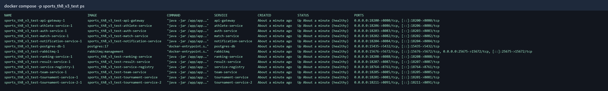
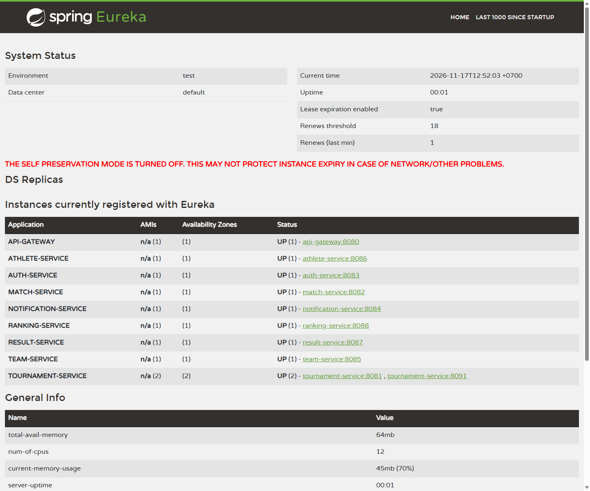

# KẾ HOẠCH VÀ KẾT QUẢ KIỂM THỬ TRIỂN KHAI DOCKER COMPOSE (BÀI THỰC HÀNH 8)

**Ngày thực thi xác nhận gần nhất:** `2026-11-17T12:50` – `12:59 +07:00`  
**Script tự động:** [`test_th8_deployment.ps1`](../../test_th8_deployment.ps1)  
**Môi trường thực thi cách ly:** Compose project `sports_th8_v3_test` (13 container chạy chính: PostgreSQL 17, RabbitMQ Management, Eureka Server, API Gateway, 9 business container + container một lần `db-init` thoát mã `0`; kiểm tra thêm `--profile monitoring` với Prometheus & Grafana và bài thử volume cũ trên `sports_th8_oldvol_test`).

---

## 1. Bảng tổng hợp kết quả kiểm thử (`DEP01`–`DEP06`, `SPORT01`–`SPORT04`)

| Mã | Tên kịch bản | Mục tiêu & Điều kiện đạt (Assertions) | Kết quả thực tế | Minh chứng lưu trữ |
| :-: |---|---|---|---|
| **DEP01** | Build & khởi động toàn hệ thống | `docker compose up -d --build` thành công; `db-init` hoàn tất; `Wait-ComposeServicesHealthy` không kẹt vì `db-init` đã thoát; 13/13 container `Up (healthy)` (`92.1s`); đủ 9 Application / 10 instance đăng ký `UP` trên Eureka (`0.1s`, gồm `tournament-service:8081` và `:8091`). | **PASS** | [`dep01-compose-ps.txt`](test-results/dep01-compose-ps.txt) [`dep01-compose-ps.png`](test-results/dep01-compose-ps.png) [`dep01-eureka-apps.json`](test-results/dep01-eureka-apps.json) [`dep01-eureka-dashboard.png`](test-results/dep01-eureka-dashboard.png) |
| **DEP02** | Kiểm tra Actuator Health, Prometheus & Bảo mật | Toàn bộ 11 endpoint Java container trả `/actuator/health` HTTP `200` với `status="UP"`, không lộ `components` (`show-details=never`); `/actuator/prometheus` trả `200` chứa metric `jvm_`; `/actuator/env` bị chặn (`401`/`403`/`404`). | **PASS** *(11/11 UP + Prometheus 200)* | [`dep02-actuator-health.json`](test-results/dep02-actuator-health.json) |
| **DEP03** | Dừng toàn bộ Provider (`tournament-service`) | Dừng cả `:8081` và `:8091`; đợi Eureka tự eviction; gọi `match-service` discovery và Gateway `/api/v1/tournaments` phải trả `503 Service Unavailable`; log `match-service` ghi rõ timestamp, tên service, `requestId` trong `[...]`, nguyên nhân và không lộ JWT. | **PASS** | [`dep03-provider-down.json`](test-results/dep03-provider-down.json) [`dep03-match-service.log`](test-results/dep03-match-service.log) |
| **DEP04** | Khởi động lại Provider & phục hồi tự động | Khởi động lại `tournament-service` và `tournament-service-2`, đợi `healthy` (`27.8s`) và Eureka cập nhật tự nhiên `2` instance `UP`; `match-service` gọi lại thành công (`200 OK`). | **PASS** *(`tournament-service:8081`)* | [`dep04-recovery.json`](test-results/dep04-recovery.json) |
| **DEP05** | Bảo toàn dữ liệu qua restart DB & service | Tạo dữ liệu thử nghiệm qua Gateway (`Tournament ID=1`, `Giai Dau Ben Vung TH8 81580`), xác nhận `COUNT(*)=1` trong `tournament_db`, chạy `docker compose restart postgres-db tournament-service tournament-service-2 auth-service` (`32.3s`), kiểm tra lại qua cả API và `psql`. | **PASS** | [`dep05-persistence-restart.json`](test-results/dep05-persistence-restart.json) |
| **DEP06** | `docker compose down` & `up -d` (không `-v`) | Dừng toàn cụm bằng `docker compose down` (không `-v`), khởi động lại bằng `docker compose up -d`; `db-init` chạy lại trên volume đã có dữ liệu, 13/13 container `healthy` sau `72.3s`, đăng nhập lại bằng user tạo trước đó (`200 OK`), `Tournament ID=1` và message persistent RabbitMQ (`delivery_mode=2`, `hostname=rabbitmq`) còn nguyên. | **PASS** | [`dep06-compose-down-up.json`](test-results/dep06-compose-down-up.json) [`dep06-rabbitmq-persistence.json`](test-results/dep06-rabbitmq-persistence.json) |
| **SPORT01** | Cân bằng tải 2 instance & Failover 1 instance | Gửi 20 request qua `match-service` -> cả `:8081` (`10`) và `:8091` (`10`) cùng xử lý; dừng `:8081`, gửi tiếp 10 request -> `10/10` chuyển sang `:8091`; khởi động lại `:8081` hồi phục đủ 2 instance (`16.5s`). | **PASS** *(10 / 10 + 10/10 failover)* | [`sport01-loadbalancing-failover.json`](test-results/sport01-loadbalancing-failover.json) |
| **SPORT02** | Luồng nghiệp vụ thể thao đầy đủ + RabbitMQ qua Gateway | Đăng nhập/cấp quyền -> tạo Sport, Tournament, Competition (`ROUND_ROBIN`), 2 Team, 2 VĐV, gán thành viên -> 2 đăng ký (`PENDING`) -> duyệt (`APPROVED`) -> xếp lịch -> `ONGOING` -> ghi nháp kết quả (`PENDING_CONFIRMATION`) -> xác nhận (`CONFIRMED`) -> `match` tự chuyển `FINISHED`, BXH (`ranking-service`) cập nhật `matchesPlayed=1`, `points=3`, `notification-service` nhận `MATCH_FINISHED` từ RabbitMQ (`notificationId=1`). | **PASS** | [`sport02-e2e-flow.json`](test-results/sport02-e2e-flow.json) [`sport02-rabbitmq-logs.txt`](test-results/sport02-rabbitmq-logs.txt) |
| **SPORT03** | Cô lập tài khoản PostgreSQL `<service>_user` & quyền sở hữu bảng | Kết nối chéo `psql -U team_user -d athlete_db -c "select 1"` phải bị từ chối (`exitCode=2`, `FATAL: permission denied for database "athlete_db"`); cả 8/8 service kết nối bằng `<service>_user` và sở hữu toàn bộ bảng trong schema `public` của database mình. *(Đã kiểm tra thêm trên volume cũ `sports_th8_oldvol_test` có bảng `sports` do user `sports` tạo trước: `db-init` chuyển quyền sở hữu sang `tournament_user`, bảo toàn bản ghi cũ và `Hibernate ddl-auto=update` khởi động `healthy` sau `16s`.)* | **PASS** | [`sport03-db-user-isolation.json`](test-results/sport03-db-user-isolation.json) |
| **SPORT04** | Tương quan mã theo dõi `X-Request-Id` qua Gateway & service | Gửi `GET /api/v1/tournaments/1` qua Gateway kèm header `X-Request-Id: sport04-trace-81580`: phản hồi trả đúng `1` header `X-Request-Id=sport04-trace-81580` (không trùng) và chuỗi `[sport04-trace-81580]` xuất hiện khớp trong cả log của `api-gateway-1` và `tournament-service-1`. | **PASS** | [`sport04-request-id.json`](test-results/sport04-request-id.json) [`sport04-request-id-logs.txt`](test-results/sport04-request-id-logs.txt) |

Tổng hợp máy đọc tại [`summary.json`](test-results/summary.json): **10/10 PASS**.

---

## 2. Kiểm tra giám sát Prometheus & Grafana (`--profile monitoring`)

- Khởi chạy `docker compose --profile monitoring up -d` trên cụm `sports_th8_v3_test`:
  - **Prometheus:** `11/11` target trong job `sports-services` đạt `health="up"` (`service-registry:8761`, `api-gateway:8080`, `auth-service:8083`, `tournament-service:8081`, `tournament-service-2:8091`, `team-service:8085`, `athlete-service:8086`, `match-service:8082`, `result-service:8087`, `ranking-service:8088`, `notification-service:8084`).
  - **Truy vấn dashboard [`sports-overview.json`](../../docker/monitoring/grafana/dashboards/sports-overview.json):** cả `6/6` biểu thức PromQL (`up{job="sports-services"}`, `http_server_requests_seconds_count`, `http_server_requests_seconds_count{status=~"5.."}`, `http_server_requests_seconds_sum / count`, `jvm_memory_used_bytes{area="heap"}`, `hikaricp_connections_active`) đều trả `status="success"`.
  - **Grafana:** datasource `Prometheus` (`uid=prometheus`) đạt `healthStatus="OK"`; dashboard `Sports Management - Tong quan dich vu` (`uid=sports-overview`) nạp đủ `6` panel.
  - Minh chứng lưu tại [`monitoring-check.json`](test-results/monitoring-check.json).

---

## 3. Ảnh minh chứng `docker compose ps` & Eureka Dashboard (`DEP01`)

### Trạng thái 13 container Docker Compose (`docker compose ps`)

### Danh sách đăng ký dịch vụ trên Eureka Server Dashboard (`:8761`)

*(Ghi chú: Hai instance của `TOURNAMENT-SERVICE` là `tournament-service:8081` và `tournament-service:8091` hiển thị cùng trạng thái `UP (2)` dưới cùng một Service ID.)*
