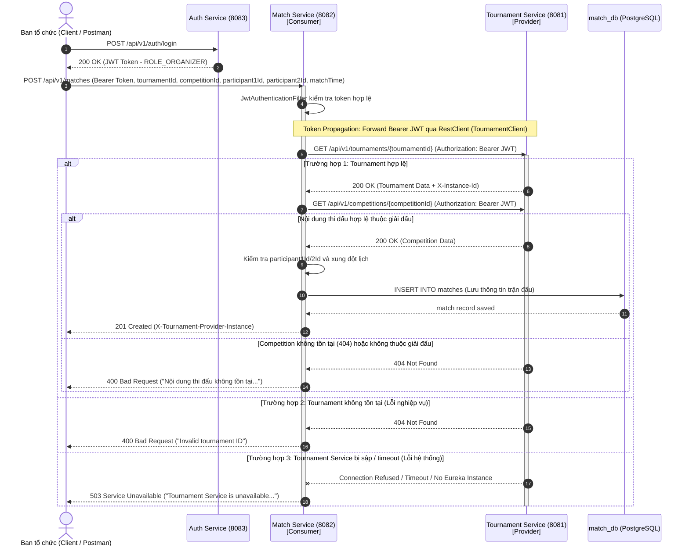
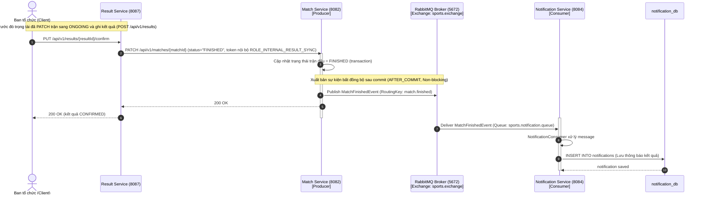

# BIỂU ĐỒ TUẦN TỰ MÔ TẢ QUY TRÌNH TÍCH HỢP LIÊN DỊCH VỤ (TH6)
**Đề tài:** Hệ thống Quản lý thi đấu Thể thao  

---

## 1. Sequence Diagram: Tích hợp Đồng bộ REST (Match Service ➔ Tournament Service)

Biểu đồ mô tả quy trình Ban tổ chức tạo lịch thi đấu. `Match Service` đóng vai trò **Consumer** gọi sang `Tournament Service` (**Provider**) với cơ chế **Token Propagation** và xử lý lỗi:

---

## 2. Sequence Diagram: Tích hợp Bất đồng bộ Event-Driven qua RabbitMQ

Biểu đồ mô tả sự kiện kết thúc trận đấu và thông báo tự động:

